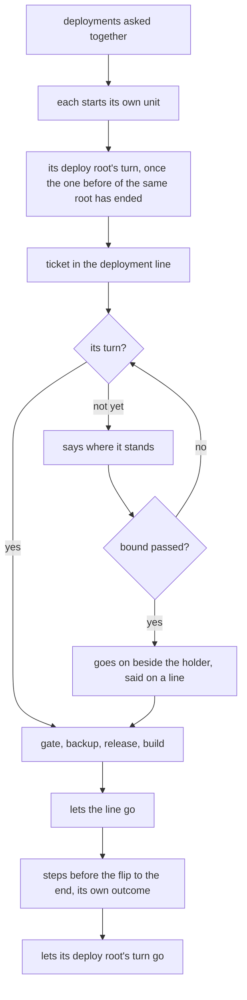
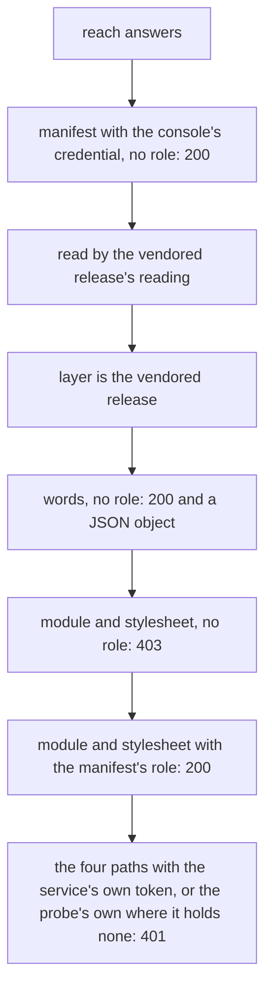

# Deployment: a repository's releases on the machine it runs on

## What it is

- **The `deploy` verb puts one commit of a repository live** on the machine it runs on, as a release
  beside the one serving, flipped onto in one rename, with its declared services restarted and
  watched, and rolled back where they do not come up. What the repository builds, which services it
  runs and how its health is read are its declaration's (`docs/declaration.md`).
- **A commit is deployed by its own declaration.** The `testbed.toml` the commit carries, read from the
  commit itself and never from the checkout's work tree, is the one its deployment runs by: whether the
  gate runs, the setup of the tree the gate reads and the gate's static check and suite on this machine,
  the release's setup and env links, the build, the deploy steps, the units it marks, the backup it takes
  and its directory, quiet, the health, the console probe and whether the backup upload starts. A commit
  that changes its own steps is therefore judged and built by the steps it changes them to. A commit
  carrying none runs by every default. The checkout's own declaration answers only what the deployment
  needs before it has picked a commit, and what reads the checkout as it stands: the repository's name,
  where the deployment stands (its deploy root, with the deploy tree, the record, the log and the
  progress under it, and its data root), the event hook, and the consumers a major change runs the
  suites of. A commit whose declaration does not read, names the repository otherwise, places the
  deploy root, the deploy tree or the data root elsewhere, or deploys nothing is refused with nothing
  changed; such a commit is deployed from a checkout brought to it.
- **The hosted deploy tool** puts a commit live for a session the verb refuses, through the tool host
  (「The hosted deploy tool」).
- **The `backups` verb** sends the backups deployments took to remote storage and keeps them rotated.
  A machine's runtime data apart from any deployment is the data backup's (`docs/backup.md`).
- **One repository, one deploy tree.** Every place below is the declaration's, relative to the
  repository's declared deploy root.

## The places

| Name | What it is |
|---|---|
| Deploy tree | A symbolic link to the live release: the one stable path every unit, every link and every caller names, moved from one release to the next by a single rename |
| Releases | `deploy-releases/` beside the link, one release per deployed commit, named by its first twelve hex digits |
| Build tree | `deploy-expand` beside the link, a detached worktree moved to each commit, where the gate run on this machine and the release build run, its target directory kept warm between deployments until the prune takes it (「The releases」) |
| Committed trees | `deploy-trees/` beside the link, one detached worktree for each repository holding a tree outside the repository its build reads by a path, moved to the head of that repository's main branch, which the release and the build tree read such a tree from (「The releases」) |
| Data root | The repository's runtime data, inside no checkout and inside no release |
| Deployment record | `deployed.json` under the deploy root, naming the commit that runs, its subject, the reason it was deployed, its deployed version (「The deployed version」), when it was laid down and the backup behind it |
| Deployment log | `deployed.log` under the deploy root, one line per deployment |
| Progress record | `deploy-progress.json` under the deploy root, where a run stands while it runs |
| Run lock | `deploy-run.lock` under the deploy root, the deploy root's turn, which the deployment under way holds to its end (「The deployment line」) |
| Backup directory | `<deploy root>/backups` unless the declaration names another, where the deployment's backup is written, readable by the user alone, inside neither the data root nor a git work tree |

- **The data root is never inside a git work tree.** A deployment finding it there does not start.
- **A deployment's own files stand under its deploy root, never in its data root.** The data root
  holds the repository's runtime data alone, so several repositories may declare the same data root
  without one deployment writing over another's record or log.
- **Every place but the deploy tree can be moved** by the variables `docs/boundary.md` lists. The
  deploy tree is the declaration's alone: every process a release starts carries `BMO_DEPLOY_DIR`
  naming its own release, so a deployment started from any of them would otherwise aim at that
  release's repository rather than its own.

## The releases

- **A release is a detached git worktree of the repository at its commit,** set up the way any
  checkout of it is: its submodules brought to the commits it pins, then the declared setup steps, then
  the declared env links. Its `bin/` holds the binaries built for that commit, and its
  `bin/built-from` names that same commit.
- **A deployment builds committed trees only.** The repository is read at the commit deployed, and
  every tree it names outside itself at the head of the main branch its own repository declares
  (`check.main`), read as `docs/declaration.md`, 「The main branch's head」, says, the remote asked
  first, so a checkout working on another branch with its own main branch left behind lays main as
  the remote holds it; never a checkout's working tree. A checkout is where a job edits, and the base libraries' and the sibling
  repositories' checkouts are shared by every repository built on them: a build reading a working
  tree compiles whatever another job has half written there, fails for a reason that is not in the
  repository it deploys, or puts that unfinished work live. The gate run on this machine, the release
  and the build tree all read these committed trees, and so does the bench on the placed machine
  (「Where a deployment runs」).
- **Once it has picked its commit, a deployment reads its repository through the repository's primary
  checkout:** the main worktree of the git directory the checkout it was asked from shares, said on a
  line naming it where it is another. A job's checkout is a linked worktree, removed once its work is
  merged, which is often while the deployment asked from it still waits for its deploy root's turn or
  the line, or runs its gate. Picking the commit reads the checkout it was asked from, its `HEAD` and
  its open changes among them, before any wait (「What the deploy run does, in order」, step 2). Every
  later step runs in the primary checkout: the build tree and the committed trees, the release, the
  prunes, the service manager, the backup and its upload, and the deployment's own process moves into it
  inside its unit, so nothing it starts inherits a directory that may go. Where git names no main worktree that stands,
  as for a bare repository, the deployment goes on from the checkout it was asked from.
- **The trees the workspace names by a path outside the repository — the base libraries and the
  sibling repositories' crates a release build reads — are laid where each manifest names them, as
  links into the committed trees, and so is every tree those trees name in turn.** A tree so named is
  built as a dependency and reads its own path dependencies, a sibling's crate reaching a third
  repository's crate by a path: the list follows the package standing in each named tree to the paths
  its manifest names, its dev-dependencies left out since Cargo reads none of a dependency's, until no
  new tree turns up, and every tree on it is laid as the first ones are. A worktree of the repository
  alone carries nothing beside it, so the release and the build tree read such a tree through a link
  laid where the path points; the
  build tree's declared path reaches the deploy root's parent, where the repositories of one
  workspace share one. A tree that is a member of another Cargo workspace — one Cargo, asked from the
  checkout's copy of it, places under a workspace root above it — reads its inherited fields from
  that root, so the link is laid at the root instead, and the named path resolves through it; every
  tree named inside one workspace shares that one link. A standalone package is linked by itself.
- **The list of trees is read off Cargo's word from the workspace at the commit deployed,** never from a
  checkout's working tree, which may stand at another commit, behind main among them, and miss a path
  dependency the commit adds. A worktree reads no manifest until the trees its manifests name stand
  where they point, so the list is read from a detached worktree of the commit made beside the primary
  checkout for the reading and taken away once it is read, named after the checkout's folder and the
  commit behind a leading dot, a leftover of a reading cut off taken away first: there, the paths the
  commit's manifests name reach what they reach from the checkout. The reading holds the commit's own
  files, its submodules left out, since a workspace's members stand in the repository itself, and a
  commit with no Cargo manifest at its root is read for nothing. The trees those trees name in turn, and where each one's
  link goes, are read from the trees beside the checkout. A tree that is no worktree of the checkout's
  repository names no commit of it, and is read from the checkout as it stands. What a link reaches is
  the committed tree alone. Where a link is to be laid, a link already on its committed tree is left as
  it is, a link pointing elsewhere, onto a checkout's working tree among them, is
  moved onto it, and a folder holding nothing but folders and links, as an earlier laying leaves, is
  replaced; any other tree standing there is left as it is.
- **The committed trees stand in `deploy-trees/`,** one detached worktree for each repository holding
  a tree on that list, named after that repository's folder with a short digest of its path, a
  tree inside the repository reached at its own path within the worktree. Each is put at its
  repository's main head the way the build tree is put at the commit (below): made where it is not
  there yet, moved by a checkout where it is, every path the head moved stamped, its submodules brought
  to their pins, and made again where it stands as a worktree of another repository. A tree the
  checkout does not carry, a tree no git repository holds, one whose repository holds the checkout
  itself, and one whose repository's main branch does not stand refuse the deployment before anything
  is built, the line naming the tree and why. Each laying reads the main head at that moment, so a
  dependency merged while a deployment runs reaches its build at its new committed head, never at its
  working tree.
- **A release is finished before anything serves from it.** Prepared and built while the live release
  goes on serving; the deploy tree's link is then moved onto it by a new link written beside the old
  one and renamed over it, so every reader sees one release or the other and never a tree half moved.
- **The build tree is stamped where its commit moved.** A build reads a source by its modification
  time against what it built before, and the build tree is kept warm between deployments. Every path
  the new commit changed is therefore stamped with the moment the tree is put at it, so a build the
  commit moves is a build that runs; a path the commit removed is none to stamp.
- **The build tree holds the commit it is moved to and nothing the commit before left.** Where the tree
  is moved from another commit, every file the new commit does not track, untracked and ignored alike, is
  taken away once it stands at the commit, all but its target directory, which stays warm. A package an
  earlier commit's setup installed, a tree its steps vendored, or a file a removed step wrote therefore
  never reaches the gate of the next commit, which judges exactly what that commit holds. A run that starts
  on the tree, the gate on this machine, finds the same taken away even where the tree already stands at
  the commit, so nothing a failed run at that commit wrote reaches it. Put again within that run, at the
  commit it already stands on, the tree keeps what the run's own setup laid there, so the build after the
  gate reads the tree the gate set up. A committed tree outside the repository is put at its
  main head the same way.
- **The build tree's target directory lasts three days past the last deployment.** The prune (「The Cargo
  build directory」) removes it once the deployment record was written more than three days ago and no
  deployment of the deploy root is running: the progress record holds no run without an ending whose
  process is alive. The next deployment builds its release from nothing. A deploy root holding no record
  that reads keeps its build tree's target directory, and the build tree itself always stays.
- **The build tree's target directory carries the release build's mark,** a file the deployment writes into
  it before its build stage begins, every time and whether or not the commit holds a Cargo workspace. The
  build tree is a checkout the gate builds in like any other, and the release build's target directory
  stands inside it, apart from the build root, so without the mark it would read as a stray `target/` a
  build typed outside the Cargo verb left (「The Cargo build directory」). Between the release build's end
  and the binaries' placement no Cargo process works in the build tree, the declared `[build]` steps
  running there instead, so only the mark keeps that window: from the start of the build until the
  binaries are placed, and past it until the span above, no rule of the prune takes the target directory.
  A binary that is gone all the same when it is placed fails the deployment with every service untouched,
  the line naming the file it looked for.
- **A build tree made from a checkout that is no longer the deployment's source is discarded and made
  again.** The tree belongs to the deployment's source only while the common git directory it names is
  that source's. A tree naming another checkout, or one whose git directory cannot be read, is removed
  through the repository it belongs to, and a new worktree is made from the source at the commit. A
  source whose own git directory cannot be read says nothing about whose tree it is: the build tree is
  left as it stands, and the deployment stops at its gate, naming the source.
- **A binary is placed into a release once.** A binary whose bytes equal the previous release's is
  hard-linked to that file; a binary that differs is copied in. What differs is what the deployment
  restarts (「The unit links」).
- **A process stays on the release it started from.** Its executable and working directory resolve to
  the release's real path, so a flip changes what the next start runs and nothing a running process
  reads. A process hands the release it reads on to what it starts, through `BMO_DEPLOY_DIR`.
- **Retention:** each deployment prunes the releases twice, before it prepares its own and once it is
  live. A prune keeps the live release, the one before it, the one the deployment itself runs from,
  the one it lays down, the one every deployment of the deploy root still under way lays down and every
  release a live process stands in, and takes every other away through the guarded removal and then
  `git worktree prune`.
  - **A deployment is under way** where the progress record holds its run without an ending, or the
    testbed's record holds it for the repository without an end, and its process lives. Its release is
    the one its commit names. The deploy root's turn keeps a second deployment from starting beside it,
    and the prune keeps its release all the same, so a deployment waiting for quiet, which no process
    stands in between its asks, keeps the release its quiet runs from whatever else prunes.
  - **A testbed's record that cannot be read prunes no release,** said on a line as a warning, as
    where the live processes cannot be read.
  - **A process stands in a release** where its working directory or executable lies inside it, or its
    `BMO_DEPLOY_DIR` names it, as `/proc` says of every process of the account.
  - **More than twelve releases left standing** after a prune sends a `releases-pinned` event naming,
    for each release kept only because a process stands in it, the processes that do.
- **A release is never cleaned.** Its untracked files belong to the runtime. A release goes only whole.

## A deploy tree that is still a directory

- **The deployment's first step adopts it,** before the backup: a deploy tree that is a real directory
  rather than a link is taken into the release layout once.
  1. A release is prepared at the commit the directory stands on, and the directory's `bin/` is
     hard-linked into it, so the binaries running now and the release's are the same files.
  2. The directory and a link onto the release are exchanged in one rename (`renameat2` with
     `RENAME_EXCHANGE`), so there is no instant without a deploy tree.
  3. The directory becomes a retired tree, `deploy.retired-<time>` beside the link, and
     `git worktree repair` points the repository's record of that worktree at it.
- **A run cut off on the way is finished by the next.**
- **The retired tree stays until nothing stands in it,** and the first deployment that finds no process
  in it removes it.
- **A deploy tree that cannot be adopted,** a directory that is not a git worktree at a commit, or a
  file in its place, is refused before the backup.

## The env files

- **Secrets are never kept in two copies.** Each declared env link is a symbolic link in the release to
  a file under the data root, so the deployment's backup carries them along.
- **A missing env file refuses the deployment.**

## The unit links

- **The installed user units the repository's services run through are symbolic links into the deploy
  tree,** under `~/.config/systemd/user/` or `$XDG_CONFIG_HOME/systemd/user/`, naming the stable path
  and never a release, so the flip moves every unit with it and a rollback's flip moves them back.
- **A unit the deployment keeps installed says so itself,** by one line in its `[Install]` section:
  `X-BMO-Deploy=` and its mark. systemd ignores keys beginning `X-`, and no list of such units is kept
  anywhere else.
  - `bot`: the one service whose health the deployment waits on. Linked and enabled, stopped,
    restarted and watched by every deployment.
  - `restart`: a service linked where no unit of its name is installed, enabled, and restarted by every
    deployment just before the `bot` service, in the order of their paths.
  - `binary`: a service that runs one of the release's binaries; linked and enabled, and restarted only
    where this deployment placed different bytes for the program its `ExecStart` names, or linked the
    unit itself.
  - `timer`: a timer, with the service of its own name beside it, linked, the timer enabled and
    started.
  - `link`: a service something else starts, or a slice other units run in, linked and nothing more.
  - `retire`: a unit that goes; once the `bot` service has come up, it is stopped,
    disabled and unlinked, a timer's service with it.
- **A unit the placed machine keeps as well says so by a second line,** `X-BMO-Placed=` and its mark,
  beside its deploy mark. Where the settings name a placed machine (「Where a deployment runs」), every
  deployment lays these units there once it is live (「What the deploy run does, in order」):
  - `timer`: a timer, with the service of its own name beside it, laid, the timer enabled and started
    there;
  - `link`: a service or a slice, laid and nothing more.

  A laid unit is the release's file as it stands, written whole under that machine's
  `~/.config/systemd/user/` and renamed over whatever stood at its name there, then that machine's user
  service manager reloaded and each laid timer enabled and started. The placed machine keeps no release
  of the repository, so a laid unit is a plain file rather than a link; it names its programs by the
  same paths under that machine's home as here, `%h` read there as that machine's home. A machine that
  cannot be reached, or a unit that cannot be laid or a timer started there, is a warning naming the
  machine and what it said, and the deployment goes on.
- **The unit files a deployment reads are services, timers and slices;** any other kind of file the
  declared globs reach is not a unit of the deployment's.
- **Before anything changes, every unit link into the deploy tree is read,** and the commit asked
  whether it has the file it points at. A link the commit would leave dangling is matched to the one
  tracked file of the commit with the unit's own name and relinked to it right after the flip. A link
  with no such file, or with more than one, is refused before the backup.
- **A marked unit installed as a plain file** is moved aside as `<unit>.before-deploy`, never deleted,
  and linked in its place; one linked anywhere but the deploy tree is relinked to it.
- **A repository with no `bot` unit** deploys all the same: it restarts what its marks say and waits on
  no health.

## The slices

- **Every unit the testbed starts or ships runs in a slice that says what kind of work it is,** so every
  line it writes carries that slice in the journal and a reader of the journal tells the work apart by it.
  The slices are this repository's own unit files in `units/`, each with a description, marked `link` and
  linked by every deployment of it like its other units.

| Slice | What runs in it |
|---|---|
| `bmo-backup.slice` | The data backup's services, `bmo-data-backup`, `bmo-data-backup-media` and `bmo-data-backup-drill` (`docs/backup.md`), and a deployment's backup upload, `bmo-backup-upload-<stamp>` |
| `bmo-check.slice` | Every check step's fence, `bmo-check-<pid>-<n>.scope` (`docs/checks.md`, 「The static check」) |
| `bmo-deploy.slice` | Every deployment's unit, `bmo-deploy-<stamp>` (「Where a deployment runs」) |
| `bmo-suite.slice` | A suite run's fence, `bmo-suite-<pid>.scope`, the daily whole run's unit, `bmo-full-suite-<stamp>`, and the test server, `bmo-test-postgres` (`docs/suite.md`) |
| `bmo-upkeep.slice` | The prune of the Cargo build directory, `bmo-cargo-prune` (「The Cargo build directory」) |

- **A slice whose file is not installed yet still takes its units:** the user service manager makes a
  slice that is named but has no file, so a unit started before the deployment that links the file runs
  all the same.

## Where a deployment runs

- **Every deploy run runs in a transient user unit of its own,** `bmo-deploy-<stamp>`, in
  `bmo-deploy.slice` (「The slices」). A run that is
  not already inside a deployment's unit starts one, prints its name and the command that reads its
  journal, and exits 0; the caller's death reaches nothing from then on.
- **A unit that cannot be started is a refusal.**
- **What runs inside a deployment's unit runs where it is,** but for the gate and the Cargo release
  build: the unit is started with `BMO_DEPLOY_UNIT` naming it, and every process in it inherits the
  variable.
- **The gate and the Cargo release build go to the placed machine** where the machine's settings name
  one (`docs/boundary.md`, 「Placement」, 「The placed machine」). The deployment benches the commit
  there, each repository holding an outside tree with it at its main head (「The releases」), pushed
  and checked out as the bench itself is, never copied from a working tree, in a bench of the repository's own that no
  run and no other repository's deployment copies into, one bench for the repository whichever of its
  checkouts the deployment is taken from, as the build tree stands apart and stands once here
  (`docs/boundary.md`, 「A deployment's bench stands apart」), and sets the bench up with the declared
  setup steps; the static check (`check static`, no test among it) and the suite then run there, each as
  that machine's own testbed verb in its own turn, and the Cargo release build runs there in that machine's Cargo build root,
  from which the deployment reads the built binaries back over `rsync` into its own build directory
  before it places them. The declared `[build]` steps, which write into the release and read the data
  root, run where the deployment runs, as does everything after the build. **The gate and the build never
  run on this machine where the settings name a placed machine, unless that machine breaks under them:** a
  placed machine that cannot be reached, before the deployment has begun there or after, hands the work to
  this machine where the placement order names it, and is otherwise waited for and the work tried again
  (「A connection that breaks under the placed machine」), the stage failing once the tries are spent; a
  bench that cannot be made ready while the machine answers fails the stage. The flaky tests a placed
  gate found stay in that machine's record, so the deployment reports none.
- **The placed machine runs this machine's live testbed release, or nothing runs there.** Before the
  bench is made ready, the commit that machine's testbed was built from is read and compared with the
  live testbed release's, the one the testbed's deploy tree names at that moment, since a testbed there
  of another release would judge the gate by other rules without saying so (`docs/boundary.md`, 「The
  placed machine」). Where they differ, or that machine's testbed names none, the deployment first brings
  that machine's testbed to the live release, copied, run there once and read back as the step after the
  switch does (below), and says so on a line. A deployment running from an older release, one that began
  before the testbed's own deployment went live, so brings that machine to the newer live release and
  never back to its own. Where that does not take, or the caller sets `BMO_TESTBED_PLACEMENT` empty, the
  stage fails with nothing changed, its reason naming both commits and what the machine answered. A
  placed machine left on another release, by a copy after the switch that did not take or by a machine
  away at that moment, is so brought to the live release by the next deployment of any repository, and by
  the next run placed there before it (`docs/testbed.md`, 「A run on another machine」).
- **A deployment of the testbed brings the placed machine's testbed to its release** once it is live
  (「What the deploy run does, in order」, step 16). A deployment is the testbed's where its release's
  `bin/` holds a file of the name the settings' `testbed` binary ends in. It reads the settings'
  `destination`, `ssh`, `machine` and `testbed`: over that `ssh` it copies the live release's binary
  of that name onto the settings' `testbed` and the release's `bin/built-from` beside it, the
  `built-from` last, each written whole beside its place there and renamed over it, so a testbed
  running there goes on undisturbed and no half-copied file is read as a match. Before the `built-from`
  is written it runs the copied testbed there once, asking its help, so a binary that does not run on
  that machine is a failure here rather than at the next run, and that machine never names the commit
  for a testbed that does not run. It then reads that `built-from` back as the gate does and checks that
  it names the commit just put live. It copies under the same lock as a run that brings that machine to the
  live release (`docs/testbed.md`, 「A run on another machine」), so the two never write over each other.
  The deployment's line names the machine, the files written there and the commit read back. A machine
  that cannot be reached, a copy or a read that fails, a `built-from` that names another commit or
  none, or a copied testbed that does not run there is a warning on a line naming the machine and what it
  answered: the deployment here stays live, and the next run or deployment of any repository placed
  there brings that machine's testbed to the live release before anything runs there (above). Nothing is
  copied where the settings name no machine, or where the deployment's caller sets `BMO_TESTBED_PLACEMENT`
  empty.
- **A passed suite is looked for in each machine's own record,** since a record is per machine and a run
  placed elsewhere is written by the machine it ran on (`docs/boundary.md`, 「The record」). The
  deployment reads its own machine's record first, before the gate is asked or placed, which holds a
  close's suite that ran here. Where that holds none and the gate stands on the placed machine, the gate
  asks that machine's record once its static check there has passed, through that testbed's `passed`
  verb in the bench, which holds a close's suite placed there. A placed machine whose testbed does not
  answer it with a run runs the suite.
- **The unit is handed `PATH` and the roots the caller resolved,** so the run aims at exactly what the
  caller aimed at, and `BMO_TESTBED_FRONT=1`, so every heavy command of the run stands at the front of
  its lane.
- **A gate's suite leaves the run where it stood.** The suite runs in the deployment's process, and its
  fence moves that process into a scope of its own; once the gate answers, the run is put back into its
  unit's control group, so every line it says afterwards, a failed stage's line with it, is read from
  the deployment unit's journal.
- **A dry run and a refusal stay in the caller's process:** a refusal exits 2 there, and `--dry-run`
  says there what the run would do, changing nothing and starting no unit.

## The deployment line

- **Deployments on one machine pass their gate and their build one after the other.** Every deployment
  stands in the machine's one deployment line, the lock `deploy-line.lock` under the testbed data root's
  `locks/`, the first to ask going first. Each one's static check, suite and release build therefore have
  the placed machine to themselves among deployments, since several side by side there each hold a seat
  and a suite's fence of their own, and together they can take that machine past the memory and disk it
  has and cut every run on it at once.
- **The verb and the hosted tool take any number of deployments at once.** Each call starts its own unit
  as before; the unit waits its turn in the line and ends with its own outcome, which its caller reads as
  it reads any deployment's.
- **One deployment of a deploy root runs at a time.** Before it stands in the line, a deployment takes
  its deploy root's turn, the lock `deploy-run.lock` under the deploy root, the first to ask going
  first, and holds it to its end, whatever its outcome; one whose process dies lets go with it. A
  deployment whose deploy root has a deployment under way, past its build and waiting for quiet or
  restarting, waits there until that one has ended, however long that takes, with no bound. Two
  deployments of one deploy root side by side would each read the live release before the other's
  flip, write over each other's progress record, prune each other's release and flip over each
  other, so the later one waits and goes on from what the earlier one left live.
  - **While it waits it says so,** at once and then at the line's pace, naming the deployment it
    waits behind. It holds no ticket in the line meanwhile, so deployments of other repositories pass
    it.
  - **A deployment started inside the unit of a run of its own deploy root that has not ended** carries
    that run on (「What a deployment says of itself as it runs」) and takes no turn of its own, since the
    run it carries holds it.
- **A deployment stands in the line once its refusals are judged** and its deploy root's turn has come,
  after the commit is read and before it writes its progress record (「What the deploy run does, in
  order」, step 2), so a refusal and a dry run never wait. A deployment waiting for either has written
  nothing into its progress record or the testbed's record yet, so two deployments of one repository
  never write one progress record at once: it is read through its unit's journal, which the hosted tool
  follows it by.
- **A repository and commit stand once.** Every deployment of a deploy root holds a ticket under its deploy
  root's turn from the moment it stands for that turn until it ends, waiting or holding it, and the ticket
  names the whole commit it asks for. Before the verb starts a unit, in the caller's own process, it
  fetches the remote, reads the commit asked for as a commit, a whole or shortened name, `HEAD` where none
  is given, and reads the commit each of those tickets names the same way, so `d935412` and
  `d9354126cf6753f0…` are one commit. Where one of them is the commit asked for:
  - **the call attaches to it and starts nothing.** It prints a line naming that deployment's unit, its
    repository and commit, how long ago it asked and how to read its journal, and exits 0, so a caller that
    follows the unit it is told follows that deployment as it would its own. Asked with `--first`, the call
    raises that deployment to first as `deploy first` does before it attaches; one that holds the line or
    is marked first already is attached to as it stands.
  - **An ask that brings what the standing one lacks stands on its own:** one asked with `--before-start`,
    `--no-check` or `--force-live`, since each is a promise of its own run.
  - **The judgement is made of the tickets standing when the call is asked.** A unit started but still
    reading its commit holds no ticket for a few seconds, so two calls in that moment each start one; the
    later of the two then ends at its turn on the commit already live, or on the failure below.
  - Where the commit or the remote cannot be read in the caller's process, the verb starts the unit as
    asked, and the unit refuses what is to be refused.
- **A commit whose gate failed and that main still stands on is refused.** Before the verb starts a unit, it
  reads the testbed's record for the newest ended deployment of the repository and the commit. Where that one
  failed in its gate (the `check` stage) and the repository's main branch, its remote's as the declaration
  names it (`docs/declaration.md`, 「The main branch's head」), still stands on that very commit, the call
  refuses with 2, naming that deployment's unit, when it ended and its reason: running the same gate on the
  same tree fails the same way, and the mend is a new commit on main. A main that has moved since, so that its
  head is another commit, reopens it, and so does an ask with `--first`, which says on purpose that the gate
  is to run again; an ask with `--no-check` runs no gate and is not refused for one. A record that cannot be
  read refuses nothing.
- **A commit whose gate failed while the deployment waited ends it at its turn.** Once its turns come, and
  before its gate, a deployment reads the record again; where a deployment of the same commit failed in its
  gate after this one was asked, it refuses with 2, naming that deployment, and lets both turns go, with
  nothing written into its progress record or the testbed's record, since that failure was told already. One
  asked with `--no-check` runs no gate and goes on.
- **Its turn reads the live release again.** Once its turn comes, the deployment reads the deployment
  record again, so the range its gate checks and the major change it judges are against what the
  deployment before it put live.
- **A deployment whose turn comes lays down the newest commit asked for behind it.** Once its deploy root's
  turn comes, it reads the deployments still waiting for that turn. Where one of them asks for a commit that
  carries its own, it puts that commit live in place of its own, the furthest on where several do, and says so
  on a line: the repository is checked, built and restarted once for all of them, and each deployment it took
  the commit of ends at its own turn on the commit already live, as below. It reads the commit it takes afresh:
  its declaration, its places and every refusal are judged of that commit, and a refusal ends the deployment
  as any refusal does. Two things keep a deployment to its own commit: its gate left out with `--no-check`,
  since the pass it stands on is its own commit's, and a waiting deployment asked with `--before-start`, whose
  command runs only in its own restart. A waiting commit whose newest ended deployment in the testbed's record
  failed in its gate is not taken, since its gate would fail again; its own deployment answers for it at its
  own turn.
- **A commit the live commit already carries ends the deployment at its turn the same way.** Where the commit
  asked for is an ancestor of the one the record read again names, laying it down would take back every commit
  after it, so the deployment says so on a line and ends live as below, laying nothing down; taking a deployment
  back is the rollback verb's (「Rollback」).
- **A commit already live when its turn comes ends the deployment there.** Where the record read again
  names the commit asked for, the deployment says so on a line, begins its progress record and ends it
  live at once, lets the line go and exits 0: no gate, no backup, no release, no restart and no event,
  since what it would lay down is what serves already. A deployment of the live commit asked while
  another stands ahead of it in the line therefore runs whole only where that other one has put
  something else live by then.
- **It holds the line from the gate to the end of the build** (steps 3 to 6), then lets it go. What
  follows waits on services rather than on any machine's threads, and the wait for quiet lasts as long
  as the work it waits on, so the next deployment's gate begins while this one restarts, where the next
  deployment is of another deploy root; one of the same deploy root still waits its root's turn. A deployment that
  ends sooner, failed or stopped, lets the line go as it ends, and one whose process dies lets go with it.
- **While it waits it says so,** every policy's seconds, sixty: how long it has waited, how many
  deployments stand ahead and which one holds the line. Once its turn comes it says how long it waited.
- **The wait has a bound and never fails the deployment.** Once it has waited the policy's minutes, 720,
  it says so on a line naming the holder and goes on beside it, outside the line. The bound stands far
  past what a whole batch of deployments takes, so only a holder that has stopped coming to an end is
  passed.
- **A deployment marked first goes ahead of every deployment waiting in the line, never ahead of the
  one holding it.** The deploy verb's `--first <why>` marks it, and so does the hosted tool's `first`
  (「The hosted deploy tool」). It stands in the line ahead of every unmarked deployment waiting there, so
  it takes the line next once the deployment holding it lets go; the holder runs on uncut, since the line
  goes to one holder at a time and is handed on only when that one lets go. Deployments marked first
  stand among themselves in the order they were marked. The mark orders the line alone: a deployment
  still waiting for its deploy root's turn waits there first come, as before, and stands first once it
  reaches the line.
- **A deployment already waiting is raised to first** by `deploy first <unit> --why <why>`, naming its
  unit, the one name a waiting deployment has, since it has written nothing into the testbed's record
  yet. The raise leaves a mark for the unit beside the line's lock, `deploy-line.first/<unit>.json`
  under the same `locks/`. The deployment reads it as it waits and moves itself ahead at once, marked
  first in the order of the raise; one still waiting for its deploy root's turn reads it as it reaches
  the line. A raise is refused, with nothing left behind, for a unit that is not a running deployment
  unit, one the testbed's record already holds, since that one has passed the line, the one holding the
  line, and one already marked first.
- **Every first mark says who marked it and why.** Who is the `--by` given, else the account the verb
  runs as; the hosted tool names the session's holder. Why is the English reason given. The deployment
  says both on a line once it is marked, its waiting lines name them, and `status` shows them beside
  its ticket.
- **`status` lists the line as it will serve it,** after the lanes and the close line (`docs/boundary.md`,
  「`status`」): the deployment holding it, then every deployment waiting, each with its repository, its
  commit, its unit, how long ago it asked, its first mark where it has one, and whether it waits in the line
  or for its deploy root's turn. The holder's ticket says it holds the line, so the one holding it is named
  even where a deployment marked first stands ahead of its ticket.
  - **Those in the line come first,** in the order the line serves them.
  - **Those waiting for their deploy root's turn stand where they will reach it.** A deployment lets the line go
    at the end of its build and its deploy root's turn only at its own end, so the line passes to the next one
    waiting there before that deploy root's next waiting deployment reaches it. `status` therefore follows the
    line one turn at a time, reading each deployment as ending once the line has passed on from it: as it ends,
    its deploy root's next waiting deployment reaches the line behind every one waiting there, or, marked first,
    by `--first` or by a raise not yet read, ahead of every unmarked one, after those marked before it. A deploy
    root whose deployment stands nowhere in the line, past its build or not yet in it, is read as having ended,
    so its next waiting deployment reaches the line at once.
  - **The deploy roots are found through the line.** A deployment about to stand for its deploy root's turn
    enrols that turn's lock beside the line's, a file for each deploy root under `deploy-line.roots/` in the
    same `locks/`, so `status` reads every deploy root that has had a deployment without knowing any
    repository. A deploy root with no ticket standing adds nothing.

## A connection that breaks under the placed machine

- **A deployment's work on the placed machine is tried again where the connection breaks under it.** The
  gate and the release build there run over that machine's `ssh`. The connection counts as broken where
  `ssh` ends with its own code, 255, or where a bench that could not be made ready or binaries that could
  not be read back leave the machine not answering. The deployment then says so on a line naming the
  machine, the work and the pause, waits the pause, and runs that work again from its bench: the whole
  gate, or the build with its read-back.
- **The pause and the tries are the policy's:** a pause of sixty seconds between tries, and as many tries
  as half an hour of pauses holds, thirty-one, so a machine that drops away for a few minutes, or keeps
  dropping away and coming back, is waited out, and one away for half an hour fails the stage.
- **Where the placement order names this machine, the work comes here instead of waiting.** The order the
  placed machine's settings keep (`docs/boundary.md`, 「The placed machine」) says where runs may go; a
  deployment whose placed machine does not answer, or breaks under the gate or the build, says so on a line
  naming the machine and the work, and runs that work here from its beginning: the whole gate as this
  machine's own, or the build in this machine's build directory. A machine that is down never holds a
  deployment.
- **Where the order does not name this machine, a try waits for the placed machine.** A try that finds the
  machine not answering is one more broken try, whether or not the deployment has begun there; nothing
  moves to the machine the deployment runs on, since the order keeps the machine that serves apart from
  the machine that checks and builds.
- **Once the tries are spent, the stage fails naming the connection:** the machine and how many tries
  running it broke on. No exit code stands in for it. The deployment's `deploy-failed` carries that
  reason, which is how the failure is told.
- **A failure of the work's own is not tried again:** a check or a suite that fails, or a build that
  fails, ends its stage at once with its own exit code, as the build's line names it.
- **A run that is no deployment's is not tried there again:** it passes on down the order, to the next
  machine that takes it or here (`docs/boundary.md`, 「The placed machine」).

## The hosted deploy tool

- **A session the verb refuses puts a commit live through the tool host.** A harness's session carries
  `CLAUDE_PID`, so `deploy` refuses it (「What it refuses」). The testbed therefore provides a hosted
  tool, which the tool host runs outside every harness (bmo-pocket's `docs/mcp-host.md`, 「Placed
  tools」), and a session calls it through `bmo use`, waiting for its answer, or with `--async` going on
  and woken by it once the deployment has ended.
- **Its full name is `testbed/deploy`:** the namespace `testbed` and the entry `deploy`, shown only to a
  session whose record holds the capability `deploy`. The entry acts, so the toolbook reaches it by
  `act`. A call waits for its deployment however long it takes; its manifest names no span.
- **Its arguments,** stated by the input schema beside its manifest:

  | Argument | Type | Meaning |
  |---|---|---|
  | `repository` | string, required | The repository to deploy, by the `name` its checkout's declaration names, with or without a leading `bmo-` |
  | `commit` | string, required | The commit to put live, by its hexadecimal name, whole or shortened; it must be on the remote |
  | `why` | string, required | Why the deploy is made, in English, handed to the verb as `--message` |
  | `dry_run` | boolean, optional | Say what the deployment would do, changing nothing and starting no unit |
  | `attach` | boolean, optional | Start nothing: answer the outcome of the newest deployment of the commit the record holds, following it to its end where it still runs |
| `first` | string, optional | Mark the deployment first in the deployment line, with this English reason, the session's holder named as who marked it (「The deployment line」). Where a deployment of the same repository and commit already waits, for its deploy root's turn or in the line, the call raises that one and follows it instead of starting another |

- **The checkout comes from the machine's registry** (`docs/suite.md`, 「The dependents of a major
  change」): the file `BMO_TESTBED_CHECKOUTS` names, or `checkouts.toml` under the `testbed/` of the
  data root `BMO_DATA_DIR` names, which the tool host hands every call from the session's record. Each
  checkout the registry lists has its declaration read, and the one whose `name` is the repository asked
  for, a leading `bmo-` taken off both, is the checkout.
- **It runs the verb in that checkout** with the commit, the reason, `--dry-run` where asked, and
  `--first` with `--by` naming the session record's `holderName` where `first` is given, its
  environment the call's with `CLAUDE_PID` and `BMO_DEPLOY_UNIT` taken out, so the verb starts its unit
  as it does for any caller outside a harness. The binary is the one of the release the tool is placed
  from, its `bin/bmo-testbed`, or `bmo-testbed` on the path where the tool runs from anywhere else.
- **It waits the deployment out by the testbed's record,** however long it runs. Before the verb runs
  it takes the number of the record's last event; it reads the unit's name off the line the verb
  prints; then, every few seconds, it reads the record's `deployment.created` and `deployment.changed`
  events after the last number it read, the same events and numbers `GET /events` streams and resumes
  from by `Last-Event-ID` (`docs/boundary.md`, 「The event stream」), and takes the deployment whose
  unit is that unit. It ends where that deployment has ended, by its own outcome or because its process
  went without ending it.
  - **A read that fails is no outcome.** A record that cannot be opened or read is read again at the
    next turn, from the same number; a resume from before the record's window reads the deployment by
    its id instead.
  - **The unit is asked as well,** every turn, whether it is still active. Where it has ended and the
    record holds no deployment of it, since a run that cannot write the record goes on without it, the
    deployment record under the repository's deploy root is judged instead.
- **It raises a deployment already waiting** where `first` is given and a deployment of the same
  repository and commit stands waiting, for its deploy root's turn or in the line: the call raises it
  as `deploy first` does, by the unit its ticket names, and follows it as it would its own, starting
  nothing; one marked first already is followed as it stands. Without `first`, the verb itself attaches to a
  deployment of the same commit standing for the deploy root (「The deployment line」) and names its unit, which
  the call then follows as it would one it started.
- **It attaches to a deployment already under way.** Where the record's newest deployment of the
  repository is still running and is of the commit asked for, the call runs no verb and follows that
  deployment as it would its own. With `attach`, the call starts nothing whatever that deployment's
  state: it answers the outcome of the newest deployment of the commit the record holds, following it
  where it still runs, and refuses where the record holds none.
- **When its host stops,** the call is ended with it. The entry declares `ends_at_stop` (bmo-pocket's
  `docs/mcp-host.md`, 「The host's stop」), since a deployment of the tool host itself stops the host
  while the call waits on that deployment: the call holds neither the host's stop nor its `quiet`, so
  the deployment never waits on its own caller. At the stop the host ends the call's process and
  answers the call as failed, saying the host stopped. The deployment runs on in its own unit,
  untouched, and a call of the same repository and commit with `attach`, once the host is back,
  answers what came of it.
- **What it answers:**
  - **live:** where the record's deployment went live, a first line `live:` with the commit and its
    subject, then the commit live before the call began where the call started the deployment, the
    reason and the unit; judged by the deployment record instead, where it names the commit asked for
    and was written after the call began;
  - **not live:** otherwise, an error answer naming the deployment, its unit, its state, the stage it
    stopped in and its reason, or, judged by the deployment record, what that record names, with the
    last thirty lines of the unit's journal;
  - **a refusal of the verb,** which ends 2, a verb that ends with any other failure, and a verb that
    names no unit: an error answer carrying what the verb said;
  - **a dry run:** what the verb said.
- **What it refuses,** as an error answer before the verb runs:
  - arguments that are not its shape, a required one empty, or a commit that is not a hexadecimal name;
  - a registry that does not stand, or does not read, named by its path;
  - a repository no checkout of the registry declares, naming the names the registry's checkouts
    declare and the checkouts whose declaration does not read;
  - a repository two checkouts declare, naming both;
  - a repository whose declaration deploys nothing;
  - with `attach`, a commit of which the record holds no deployment of the repository, or a record that
    cannot be read.
- **The testbed's own deployment places it,** before the flip: the tool's executable, its manifest and
  its input schema are copied into the release's `tools/deploy/.placed/`, which is put into the tool
  host's registry for the service `testbed` with the capability `deploy` allowed.

## What the deploy run does, in order

1. **Check the data root and the backup directory,** and stop where either stands where it may not
   (「What it refuses」).
2. **Pick the commit.** After `git fetch`, take the commit `--commit` names, or the checkout's `HEAD`,
   and check it is on the remote. Read the commit's declaration, and stop where it does not read, names
   the repository otherwise than the checkout's, places the deployment elsewhere or deploys nothing, or
   where an env file it declares is missing. Check every unit link will still find its unit file. From
   here on, read the repository through its primary checkout (「The releases」). Then
   take the deploy root's turn once no other deployment of it is under way, stand in the deployment line
   until its turn comes or its bound passes, and read the deployment record
   again, ending there, live, where it names the commit (「The deployment line」). Adopt a deploy tree that
   is still a directory.
3. **Pass the gate:** the declared static check and the suite over the range from the deployed commit,
   each heavy command at the front in its lane's deployment's seat (`docs/testbed.md`, 「The front of the
   line」), with what failed run once more, on the placed
   machine where the settings name one (「Where a deployment runs」). `--no-check`
   leaves it out where the caller already ran it, and so does a declaration with `gate = false`. The
   deployment asks the gate through a hand of its own, which the binary answers with the suite's
   static check and run, so a test stands in for it.
   - **The whole gate is left out where it already passed on the same ground.** A gate that passes is
     written into this machine's record (`docs/boundary.md`, 「The record」) by the deployment itself:
     the repository, the commit, the commit the range began at (none where nothing was live), the head
     of every repository the gate laid beside the tree it judged, and the tree's toolchains as the
     `toolchain` verb answers them where the gate ran (`docs/boundary.md`, 「`toolchain`」), with the
     machine it ran on. Every later gate, once it has laid its tree and read its toolchains, asks the
     record for a pass of the same repository, commit, range, heads and toolchains written within the
     policy's hours, twenty-four. Where one stands the gate runs nothing, neither the static check nor
     the suite, and the deployment says on one line that the gate is left out, naming when the pass was
     written and the machine it ran on. Anything less certain runs the gate: a sibling's head that
     moved, another toolchain, another range, a pass older than the limit, or toolchains that could not
     be read, which find no pass and write none. The suites a major change runs are never left out.
   - **The suite is left out where it already passed on the commit.** The close that landed the commit
     ran the repository's whole suite on it (`docs/testbed.md`, 「The close line」), so a passed run of
     it is taken in place of the gate's own. The run taken is the newest test run of the repository's
     whole suite (`docs/boundary.md`, 「Members」: kind `suite`, `whole`) begun on exactly the commit,
     from a checkout with no uncommitted changes to tracked files (`clean`), within the policy's hours,
     twenty-four; where it passed, the gate runs its static check alone, and the deployment says on one
     line that the suite is left out, naming the run: its id, when it began, the checkout it ran in with
     the machine where that is not this one, and its log. Anything less certain runs the suite: no such run; the newest one failed, was
     not run, still runs or is gone; a run on another commit, from a tree with uncommitted changes, or
     begun before the limit; a run whose commit, tree or wholeness the record does not hold. The record
     is asked where the run would have been written (「Where a deployment runs」). The suites a major
     change runs are never left out.
   - **The gate reads the commit's committed trees.** On this machine it runs in the build tree, put at
     the commit with the trees outside the repository laid at their committed heads (「The releases」)
     before the static check begins, and never in the checkout, whose working tree may stand anywhere; on
     the placed machine it runs in the bench, made ready the same way. A build tree or a tree outside
     the repository that cannot be laid stops the deployment in the check stage with nothing changed.
     The build tree holds the commit and nothing another commit's setup left in it (「The releases」).
   - **The gate goes by the commit's declaration.** Its setup, its static check and its suite are the
     ones the commit declares, as the bench on the placed machine reads them from the commit too; the
     checkout's working tree, which may stand at an older commit, declares none of them.
   - **The tree the gate reads is set up first.** The `[test].setup` steps the commit declares run
     there, in order, before the static check and the suite, so a fresh tree holds the packages its
     check needs (`docs/declaration.md`). A step that fails stops the deployment in the check stage with
     nothing changed. The gate is left out by `--no-check` or the commit's `gate = false`, and the setup
     with it. A release prepared later is set up again in its own tree, by the steps its commit declares
     (「The releases」).
   - **The gate judges the deployed repository alone.** Its formatting and its lints read the
     repository's own packages, the members of its Cargo workspace standing inside its root, and never
     a package outside it: neither a sibling repository's crate the workspace names by a path, nor the
     other members of the workspace that crate belongs to. A sibling is read only where the repository's
     own crates compile against it, at its committed head; its warnings are shown and never denied. A
     sibling's formatting or lints therefore never fail a deployment, and its uncommitted changes are
     never read, while every file of the repository's own is judged in full (`docs/checks.md`,
     「The static check」). A declaration declares no step of its own that formats or lints these
     packages (`docs/declaration.md`); one that still declares a step only repeating them, such as a
     `cargo fmt --all --check` that would follow a path dependency into a sibling's tree, has it left
     out for them. A sibling whose version has moved past the one the repository's lock names fails
     nothing, since the lock's path packages are brought to their manifests before the lints and the
     build (「The Cargo build directory」). A sibling whose committed head does not compile still fails
     the gate, since the repository's crates that depend on it cannot be checked, and the release build,
     which reads the same committed tree (「The releases」), would fail on it as well.
   - **A major change runs its consumer's suites as well.** The major of the commit's deployed version
     (「The deployed version」) is compared with the version in the deployment record of the release live
     before it; where they differ, the deployment runs `dependents --run` (`docs/suite.md`, 「The dependents of a major
     change」) after the gate and before the backup. A consumer's failure stops the deployment with
     nothing changed. `--no-check` leaves the gate out but not this run.
4. **Take the backup,** before anything changes (「Backups」).
5. **Prepare the release,** pruning the releases first. A release of that commit still standing whose
   `bin/built-from` names it is taken as it stands; otherwise it is made afresh.
6. **Build,** for a release made afresh: the build tree's target directory marked as the release build's
   own (「The releases」), then the Cargo release build, on the placed machine where the
   settings name one, then the declared `[build]` steps in the build tree, then the
   declared binaries placed into the release's `bin/`, hard-linked or copied, the ones that differ
   noted. `bin/built-from` is written last. A taken release is compared with the live one instead. A
   build that fails stops the deployment with every service untouched, its line naming the step and
   the exit code it ended on, or the connection where that broke (「A connection that breaks under the
   placed machine」). The deployment line is let go here.
7. **The steps before the flip,** declared under `[deploy]` with that phase: each runs in the release;
   one that fails stops the deployment with nothing flipped.
8. **Wait for quiet,** where the declaration names a `quiet` command: run from the release, it answers 0
   where no work stands under way that a restart would cut. Quiet is each unit's own count of its work
   that cannot be resumed: work the unit holds and would lose at its stop, such as a call answered over
   a connection its caller cannot ask again. Work that outlives the restart is not counted: a turn or a
   job kept in a store that a caller re-attaches to, a notice still owed and sent again once the unit is
   back, a deployment running in its own unit. Nor is work that waits on the unit's own stop, such as a
   call waiting on this very deployment, since counting it would leave the deployment waiting on itself;
   such work is ended at the stop and says so to its caller. Its exit code says which answer it gives:
   - **1 names work under way.** The line says so with what the command named, and it is asked again
     every few seconds (the testbed's policy) until it answers 0, however long the work takes.
   - **Any other answer is a quiet that could not tell:** another code, an end by a signal, or a command
     that did not start. A quiet that cannot read its own state, such as a release's quiet reading a
     table only that release's migration makes, would answer the same way for ever, so it is asked again
     at the same pace and the line says what it said. Once it has answered so a number of asks running
     (the testbed's policy), the deployment fails with nothing changed, its reason the quiet's last code
     and its own words, and it is neither recorded nor flipped. An answer of 0 or 1 between them starts
     the count again.
   - A deployment asked with `--force-live` does not wait: it says what the quiet answered, the work it
     cuts or the failure it could not tell past, and goes on at once.

   This is the last step before the record, so the moment it answers 0 is seconds before the services
   stop.
9. **Record it** in `deployed.json` and `deployed.log` under the deploy root. The record names, beside
   the commit, its subject, when it was laid down and the backup, the reason the deploy was made and
   the deployed version: the reason is `--message` where the caller gave one, else the commit's
   subject; the version is the one 「The deployed version」 names, read when the commit was picked. A
   relaunched session reads the reason and the version to say which unit was deployed and why.
10. **Flip the deploy tree:** confirm every unit link will resolve in the release, write a new link
   beside the deploy tree and rename it over the old one.
11. **Restart:** relink the dangling unit links, link the marked units, reload, restart the `restart`
    units and the `binary` units whose binaries changed, then the `bot` service.
    - **Every unit drains on its stop.** Asked to stop by `SIGTERM`, a unit takes no new work, ends or
      hands over what it holds, keeping what a caller re-attaches to, and then exits; work begun between
      quiet's 0 and the stop is drained like any other. A unit's drain is its own repository's; the
      deployment sends the stop through the service manager and waits for the unit to end.
    - With `--before-start <command>`, stop the `bot` service, run the command, then start it.
    - Wait until the declared health answers 0, until the `bot` service gives up starting, or until the
      wait's bound passes, whichever comes first. The service gives up starting where systemd holds it
      failed or inactive, or has restarted it since the wait began, which says the process the restart
      started has ended. The bound is the declaration's `health_wait_seconds`, else the testbed's policy,
      ten minutes, counted from the start of the wait: a service that stays running and never says it is
      ready, such as one waiting on a credential nobody has given it, is held to it like one that does not
      start. An ask of the health is waited for until it ends, and one still running when the bound passes
      is ended there with every process it started. Then read the unit once: up is active and running. A
      `bot` service with no health declared is up where that reading finds it running.
    - A unit that will not restart, one that gives up starting before its health answers, one whose health
      has not answered when the bound passes, or one not read running once it came up is rolled back
      (「Rollback」). The deploy output says which of them it was, how long it waited and what the last
      ask heard.
    - Then the `retire` units go.
12. **Probe the console face,** where the declaration brings a console screen (`docs/declaration.md`,
    `[deploy.console]`): the probe asks the service as a console would, point by point, and the first
    point it refuses fails the deployment, which says the point and rolls back as a service that did not
    come up does (「The console probe」, 「Rollback」).
13. **The steps after the health,** declared with that phase, in order, each run until it ends. One that
    fails fails the deployment: the deploy output says the step, its exit and what it said, the steps after
    it are not run, and the deployment rolls back as a service that did not come up does (「Rollback」),
    since what the release declares it needs once it is up did not happen. A step is written to do only
    what is due, so the next deployment runs it again from where it stands.
14. **Prune the releases.** A release that cannot be removed is a warning.
15. **Lay the placed machine's units,** where the settings name a placed machine and the release marks
    units for it (「The unit links」). What fails there is a warning.
16. **Bring the placed machine's testbed to the release,** where the deployment is the testbed's and
    the settings name a placed machine (「Where a deployment runs」). This stands after every step that
    could still roll the deployment back, so that machine never runs a release this one has left. What
    fails there is a warning.
17. **Start the backup upload,** where the declaration names a remote, as a transient user unit of its
    own, `bmo-backup-upload-<stamp>`, in `bmo-backup.slice`, running the `backups` verb in the primary
    checkout (「The releases」), and end without waiting for it.

- **The deployment ends** with its outcome written into the progress record and the testbed's record,
  and only then sends its `deployed` event naming the commit, the flaky tests its gate found, and the
  warnings. A deployment that does not go live likewise writes its outcome before it sends
  `deploy-rolled-back` and `deploy-failed`, so an event hook that is slow never holds a deployment
  unended (`docs/boundary.md`, 「Events」).

## The deployed version

The set the repository belongs to stands at one version, which moves only at a release the owner declares
(bmo-chat's `docs/conventions.md`, 「Versions」); between releases the deployed state is the day's nightly.
The deployment names which of the two it laid, as its record's `version`, read once it has picked its
commit.

- **The declared version** is the one the commit itself carries: its `VERSION` file's content where it
  holds one, else the version its root `Cargo.toml` names in `[workspace.package]` or `[package]`, else the
  `version` of its root `package.json`. A commit declaring none is deployed all the same, its version left
  empty.
- **A commit the release tag names is that release.** Where a tag `v<declared version>` points at the commit
  itself, the deployed version is the declared one, as `1.0.0` for the commit tagged `v1.0.0`. The tags are
  read from the repository as the deployment's fetch left it.
- **Any other commit is the day's nightly:** `<major>.<minor + 1>.0-nightly.<YYYYMMDD>`, the minor above the
  declared version, which names the last release, then the day the deployment picked its commit in the
  platform's time zone, Asia/Seoul, which the testbed's policy holds as its distance from UTC: so
  `1.1.0-nightly.20261124` for a commit after `1.0.0` deployed on that day. A declared version carrying a
  pre-release of its own counts from its major and minor alone. Semver orders every nightly after the
  release before it and before the release it leads to. A declared version that is no semantic version is
  recorded as it is written.
- **The nightly is a name, never a version anything declares.** No manifest and no tag holds it; which
  change is live is the record's commit, which the record names beside it.

## The set's release

The `release` verb moves every repository of the set onto the version the owner declares, each in one commit
of its own, and tags each `v<version>` (bmo-chat's `docs/conventions.md`, 「Versions」). It knows no repository
by name: the set is what stands in the folder `--set` names.

- **The set's repositories:** the git repository whose root is that folder, which holds the set's index, and
  every one whose root stands directly in a folder directly inside it, each read through its primary
  checkout. A folder whose `.git` is a file is a linked worktree, a job's, and is passed over unsaid. A
  repository two clones reach, by one `origin` remote, is released once, from the clone whose folder's name
  ends the remote's repository name, else from the first by path; the other clone is named as passed over,
  and so is a repository with no `origin` remote, since nothing of it can be pushed.
- **Each is read as its remote's main holds it:** fetched with its tags, then read at `origin/<main>`, the
  main branch its own declaration names, never from a working tree.
- **The last release** is the newest tag `v<major>.<minor>.<patch>` carrying no pre-release that more than
  half of the set's repositories hold, so an upstream's own tags kept in a fork never count. The version asked for is a semantic version with no pre-release above it, or
  above `0.1.0` before the set's first release. A version a repository already holds a tag of is refused.
- **What it sets:** a unit's own version, which is the last release's version, or before the first release
  `0.1.0` or `0.1.0-rev.<n>`, wherever a repository declares it. Any other value, an upstream's package
  kept under a fork among them, is left as it stands. Each file is read with its format's own reader and
  changed where the value stands, so every other byte keeps its layout:
  - a `Cargo.toml`'s `[package]` and `[workspace.package]` `version`, and in each of its dependency tables
    the `version` of an entry taken from a sibling by `path`, its operator kept;
  - a `Cargo.lock`'s packages read from a path, never a registry's;
  - a `pyproject.toml`'s `[project]` and `[tool.poetry]` `version`;
  - a `VERSION` file;
  - in a JSON document, each member of its top-level object whose value is the unit's own version, a build
    suffix such as `+source` kept, and an OpenAPI document's `info.version`: the `version` of a package
    manifest, a plugin manifest and an application's configuration among them;
  - and in a markdown document, the version after "Fixed at" on the line that fixes it.

  The major a declaration names in `testbed` is its schema's, not the set's, and a release leaves it
  (`docs/declaration.md`).

  A file under a `node_modules/` or a `fixtures/` folder, or one the declaration's
  `[check.shared_versions] exclude` reaches, is not read. Every other file still naming a unit's own
  version in a form that can only be one is named as left as it stands, for its repository to move.
- **The release, in order:** every repository read and its changes worked out before anything changes, so a
  file that does not read refuses the whole release; then for each repository a detached worktree of
  `origin/<main>` in a scratch folder, the changes written there and committed as `Release <version>` where
  anything changed; then each commit pushed onto the remote's main; then each repository tagged
  `v<version>` with an annotated tag, on its release commit or, where it changed nothing, on its main's head,
  and the tag pushed; then the scratch worktrees removed. A push that fails stops the release there, naming
  what landed and what did not, and no tag is made before every push has landed. A repository that declares
  no version is tagged all the same, so every repository of the set names the release.
- **`--dry-run`** reads and works everything out the same way and prints it, changing nothing but the
  fetch.
- **`--propose`** reads, in each repository, the commits on its main since its last release tag, or every
  commit before the first, and proposes a step by each commit's subject: one marked breaking, or opening
  with a word the policy names for taking away or renaming, proposes a major release; one opening with a
  word for adding, a minor one; any other, a patch. It prints each repository's counts with one subject of
  its strongest step, then the set's step, the strongest of them, and the version it leads to. It proposes
  only: the owner's word settles the release.
- **`--repository <name>`** limits what a dry run or a proposal prints to the repositories of that name,
  their remote's repository name, so an answer cut at the ceiling is read whole by parts. A release itself
  always moves the whole set.

## The console probe

A service bringing a screen to a console is held to bmo-ui's console plugin contract (bmo-ui's
`docs/console-bundles.md`) once it has started, so a release whose console face breaks the contract never
stays live. The contract is the one statement of what is asked; the probe asks the parts of it a console
meets first, as a console asks them.

- **What it asks with.** The declared `reach` command runs from the release and answers the service's base
  address, the console's credential and the service's own token. The two credentials go as bearer tokens;
  neither is written into the deployment's output, its record or its events. A service holding no token
  of its own answers none (`docs/declaration.md`, `[deploy.console]`): the probe then makes a credential of
  its own, one no service holds, asks with it where it would ask with the service's token, and says so on
  one line. The contract refuses every call lacking the console's credential with a 401, so the point
  holds a face to the same answer either way.
- **The release the manifest is held to.** The shared versions the declaration names
  (`[check.shared_versions]`) pin the release of the console layer every console and bundle builds on, by
  its version, its packed file and the file's sha256, and list the earlier releases it stays compatible
  with the same way; the pinned release and the compatible ones are the pin's range (`docs/checks.md`,
  「The quick checks」, `shared-versions`). A console attaches a bundle built on any release of the range,
  so the probe holds the release being deployed to the one release of the range it vendors. Shared
  versions that do not read fail the probe. Where they pin none, or the declaration names no shared
  versions, the manifest is taken as it was answered, its reading and its layer's point are passed over,
  and the deployment says so on one line.
- **The vendored release.** A release of the range is vendored where the release being deployed tracks a
  file under that release's file name whose bytes hash to that release's sha256, as every client vendors
  it; every tracked copy of the name is tried, so a stale copy beside it does not hide it. The releases are
  tried in turn, the pinned one first and then the compatible ones in the order the shared versions list
  them, and the first vendored one is the release the manifest is held to. A release tracking no release
  of the range fails the probe, naming the range's files.
- **The manifest's reading is the layer's own.** The manifest is read by the layer's shared reading of it,
  the module `console-manifest` of the vendored release, through bmo-chat's console face, which runs it by
  Bun on that release's packed file (bmo-chat's `docs/console-face.md`). The testbed carries no reading of
  its own, and takes the contract's route and the headers a console sets from the same console face, so a
  manifest the contract refuses is refused here as the layer words it.
- **The points, in order.** The first that does not hold fails the probe:

  - the manifest at `/console-manifest`, asked with the console's credential and no owner key or role,
    answers 200;
  - the release vendors a release of the pin's range, and the manifest reads by the reading in its packed
    file;
  - its `layer` is the vendored release's version;
  - its words, asked the same way, answer 200 with a JSON object;
  - its module, and its stylesheet where it names one, asked with the console's credential and no role,
    answer 403; where the manifest names share reads they answer 200, since a reader with no sign-in
    loads them;
  - the same, asked with the manifest's role as `Owner-Role`, and an owner key as `Owner-Key` where the
    manifest asks for one, answer 200;
  - the manifest, the words, the module and the stylesheet, asked with the service's own token and the
    manifest's role, answer 401, and so do they asked with the probe's own credential where the service
    holds no token. Only these four paths are asked so: a service whose API prefix is its root still
    answers its own token on every other route.
- **A wait that runs out is a refusal.** Each ask waits the policy's seconds, thirty, for an answer, as a
  console leaves out a service that does not answer.
- **How a refusal reads.** The deployment fails at the stage after the health, naming the point, what it
  asked and what came, and rolls back where a `bot` service stands to restart (「Rollback」). A repository
  with no `bot` service fails the same way with nothing rolled back.

## What a deployment says of itself as it runs

- **Every run writes where it stands into one progress record,** `deploy-progress.json` under the
  deploy root, or the file `BMO_DEPLOY_PROGRESS` names, from the moment its turn in the deployment line
  comes (「The deployment line」). A reader needs only the file and the run's process.
- **It names from its start every stage the run means to pass,** its plan: `check`, `backup`, `tree`,
  `build`, `before`, `restart`, `stay-up`, `after`; `rollback` is never planned. Each stage is written
  with when it began.
- **Each heavy step is written as it begins and as it ends,** with its exit code, how long it waited
  for its turn and how long it ran, under the stage it ended in. A heavy step that neither writes nor works for
  the silence limit while it holds its lane's turn is ended as hung and fails with exit code 124
  (`docs/testbed.md`, 「A holder whose command falls silent lets go」). A step whose command a signal
  ended is written with exit code 1, and the gate's lines for it name the signal in place of an exit
  code (`docs/checks.md`, 「The static check」). Steps are named by their declared
  English ids. A declared step the static check left out as repeating the Cargo workspace check is
  written as passed, exit 0 with no wait and no run (`docs/checks.md`, 「The static check」).
- **It ends with an outcome:** `live`, `rolled-back`, `failed`, or `stopped` where nothing went live by
  the run's own judgement, with the reason beside it.
- **A run that dies leaves the record unended.** Its process gone, a reader takes it as cut off; the
  next run writes over it.
- **The testbed's record holds the same,** written with every change of the progress record as the
  deployment the HTTP service answers, with every line the run says as one of its log lines, and,
  before every unit the run stops or restarts, a restart naming the unit and why, for the unit to read
  as it starts again (`docs/boundary.md`, 「The record」).

## A deployment cut off in the middle

- **`deployed.json` then names a commit the `bot` service has not started on.** The record is written
  once the release is built, just before the flip, so the deploy tree stands on the new release or the
  one before, while the service is still the one that started before, or is down.
- **A cut before the flip leaves the live release serving;** the half-made release is made afresh by the
  next run of its commit.
- **The remedy:** `deploy --commit <that commit>` takes the release still standing, flips onto it again
  and starts the service on it.

## Rollback

- **When:** a unit cannot be started or restarted, the `bot` service gives up starting before its health
  answers, its health has not answered when the wait's bound passes, it is not read running once it came
  up, the console probe refuses it, or a step after the health fails. A repository with no `bot` service
  has nothing to restart, so a probe or a step after the health that fails there fails the deployment with
  the tree left on the new release, and the output says so.
- **What the deploy output says first,** so the reason survives the rollback: what was waited for and
  what the last ask heard; the unit as systemd holds it, its state, its main process, its restarts and
  last exit status; the machine's load and its pressure stalls; the tail of the service's journal since
  the restart.
- **The deployment rolls back to the release that was live before,** at once:
  1. stops the service that did not come up;
  2. flips the deploy tree back onto that release, which a deployment never prunes, and relinks the
     dangling unit links, with no setup and no build;
  3. writes that commit back as the deployment record, with a line in the log saying it was a rollback;
  4. reloads the units and restarts the service, with the `binary` units whose binaries differ between
     the two releases;
  5. waits for the health again, under the same bound, and reads the unit the same way.
- **The release tree and the service manager are reached through two hands,** one for the tree and one
  for the services, so a test drives a rollback with stand-ins for both.
- **It moves the code alone.** Data the failed release wrote stays; the backup the deployment took
  before anything changed stays for the case where that is not tolerable.
- **What is not rolled back:** a first deployment, a deployment with `--before-start`, and a release
  that no longer stands or a flip that fails, where the service is left down and the event says so.
- **Nor a deployment a later one has overtaken.** Deployments of one repository pass the line one after
  the other but wait for their services side by side, so a later one can flip the tree, write its record
  and restart the service while an earlier one still waits. Where the deployment record no longer names
  the commit that failed, the tree and the service are the later deployment's: the earlier one fails,
  saying which commit the record names now, and leaves them untouched, stopping nothing.
- **It sends a `deploy-rolled-back` event** naming the commit that failed, why, the commit rolled back
  to, whether the service answers now and the journal to read, and the deployment still fails with a
  `deploy-failed` event.
- **A rollback by hand** is an ordinary deployment of the older commit.

## What it refuses

- **A harness's shell.** A process a harness started, `CLAUDE_PID` set, is refused before anything is
  done. A harness's session deploys through the hosted tool (「The hosted deploy tool」).
- **A checkout with uncommitted changes to tracked files,** where the run takes the checkout's own
  `HEAD`; a run handed `--commit` reads nothing of the open files.
- **A commit the remote has never seen.** A commit only on this machine can never be fetched again if
  the disk dies.
- **A unit link the commit would leave dangling** with no single file of its name to relink to.
- **A data root inside a git work tree,** and **a missing env file** the commit's declaration links.
- **A commit whose declaration does not read,** names the repository otherwise than the checkout's,
  places the deployment elsewhere than the checkout's does, or deploys nothing.
- **A backup directory inside the data root or inside a git work tree.** Every file the backup writes
  and takes away again, its staging, its scratch, a part file and a backup that failed, goes through
  the guarded removal, which nothing inside the data root passes.
- **Any deletion inside or above the data root.** Every deletion the deployment makes goes through one
  guarded removal that refuses both directions.

## Backups

- **The backup is taken by the deployment, before anything changes,** into the backup directory:
  `<name>-<date>-<time>.tar.zst`, the name declared, a two-digit ordinal added where two are taken in
  one second.
- **What goes in:** the declared snapshot command's output first, the copy and its manifest the command
  writes into a scratch directory, held in the archive as `.backup-snapshot/`; then the data root packed
  as it is, the declared exclusions left out.
- **How it is compressed:** one tar stream through `zstd -T0` at level 3. A file that changes while tar
  reads it goes in as it stood, which tar ends with exit code 1, a backup taken; any other tar failure
  fails the deployment with nothing changed.
- **Read back as it is packed, once:** every byte written is also hashed and decompressed through a
  second zstd and tar, which take the snapshot out again; the file is then read back from disk and
  hashed again, and the snapshot held to its manifest by the declared verify command. Any mismatch
  deletes that backup and fails the deployment.
- **Each part is timed apart** and written as a step of the progress record: `snapshot`, `pack`,
  `check`.
- **The backup directory is readable by the user alone,** since it holds env files.

## Sending backups away

- **The `backups` verb,** started by every deployment as its last step in a unit of its own, and run by
  hand the same way.
- **One at a time:** a run that finds another going waits for it to end, however long it takes, saying
  so every thirty seconds, then works on what it left.
- **What it sends:** every backup in the directory not yet confirmed, newest first, unless as many newer
  ones as are kept already stand remotely.
- **A copy is confirmed only once read back.** The local file's SHA-256 is taken; it is uploaded with
  that checksum as the object's `sha256` metadata, unless an object of its name already stands and
  reads back matching; the object is read back whole and its size and SHA-256 must match; a match
  writes a receipt beside the backup, `<name>.sent`, holding the checksum, and a mismatch removes the
  object.
- **Then the rotation:** remotely, every object past the newest kept, five unless declared, is removed;
  locally, every backup but the newest is removed with its receipt, or where as many newer copies as
  are kept stand remotely.
- **A failure never touches the deployment,** which ended before the upload began. A step that fails
  leaves its backup on the local disk, the run goes on with the others, and a `backup-upload-failed`
  event names each backup, the step and what the command said.
- **Remote storage** is an S3-compatible bucket reached through the AWS command with a profile, both
  declared.

## The Cargo build directory

- **One build root holds every checkout's builds:** `~/.local/share/bmo/cargo-target` unless
  `BMO_CARGO_TARGET_DIR` names another. Each checkout that builds through the Cargo verb builds in a
  directory of its own under its `checkouts/`, its build directory and its target directory at once.
  Cargo holds one lock over a build directory for the whole of a build, so a directory of its own is
  what lets the checkouts' builds run side by side, each in its own seat. Each checkout compiles its
  dependencies once in its own directory, and builds after its first keep them.
- **A build keeps incremental state in every profile,** as Cargo's own default for the development and
  test profiles does and as its `incremental` setting allows a release. The Cargo verb sets
  `CARGO_PROFILE_DEV_INCREMENTAL`, `CARGO_PROFILE_TEST_INCREMENTAL` and `CARGO_PROFILE_RELEASE_INCREMENTAL`
  to `true`, over the profiles' own word, unless its caller already names them. A checkout is built
  again after each small change, a deployment's bench after each commit, and with the state kept the crate
  that changed is compiled in a fraction of the time. The state stands in the checkout's directory, one
  session a crate, and the prune takes it back from a working checkout once it has stood unchanged for its
  span. A deployment's release build is the same crates after each commit, so with the state kept in its
  bench it compiles the crate that changed in seconds where the whole of it is minutes. The one variable
  that sets incremental state for every profile is never set, since the compile cache refuses to run under
  it.
- **A dependency compiled in one checkout is not compiled again in another** where the machine has the
  compile cache the Cargo Book names for sharing built dependencies between workspaces, `sccache`, on its
  search path: the verb names it as `RUSTC_WRAPPER`. The cache keeps what is compiled without incremental
  state, which is every dependency from a registry, and passes the workspace's own crates through. A
  caller that names `RUSTC_WRAPPER` keeps its own, and a machine without the program builds as it always
  did. The cache is the program's own, in its own directory and under its own size limit; each checkout's
  directory still holds the units its builds stand on.
- **Every build goes through the Cargo verb,** which sets the build directory for whatever checkout it
  runs in, a scratch clone as much as a repository of the umbrella. A build typed outside the verb,
  plain `cargo`, lands in the checkout's own `target/` and shares nothing; such a `target/` is a
  stray the prune takes away.
- **A lock's path packages follow their manifests.** A package Cargo reads from a path, a sibling
  repository's crate or a base library, stands in the lock at the version its manifest names, and the
  sibling moves that version with commits of its own. So before a command that holds the lock, one
  naming `--locked` or `--frozen`, the Cargo verb lets Cargo resolve the workspace offline and write the
  lock just before the command starts, and keeps what it wrote only where the path packages alone moved:
  every package from a registry or a git source stands in it as it stood, and so does the lock's own
  format. The resolution is Cargo's update of the workspace with nothing freed to move, which reads the
  registry's index from the machine's cache and fetches no package's source, so a machine whose cache
  lacks the source of a package none of its builds compile aligns its lock as every other does. The verb
  then says on one line which path packages moved, from which version to which. Where anything else
  moved, or Cargo could not locate the workspace, read its lock or resolve offline, the lock is put back
  byte for byte, the verb says on one line why it left the path packages as the lock holds them, and the
  command judges the lock as it stood, so a registry package's lock is held exactly as `--locked` holds it.
  Once the command ends, the lock is put back as it was found, unless something else has written it
  since, so the checkout's tracked files never change under a check and a deployment never finds its
  checkout holding uncommitted changes a check left (「What it refuses」). A lock that already matches
  its manifests is left untouched, and so is the lock of a command naming its manifest by
  `--manifest-path`. The release build does the same in the build tree around its run (「The
  releases」), and a run of the suite that tests a crate does it once around the whole run, since its
  crates' tests run outside the verb and may run Cargo themselves (`docs/suite.md`, 「Heavy units run in a
  lane of one」), so a
  sibling's new version fails no gate, no check, no suite and no release build.
- **Removing what a build superseded.** After a build, check, lint, test, bench or run the Cargo verb
  carried has passed, the units of the checkout's own crates that its earlier builds left and this one
  replaced go. What a build stands on is Cargo's own word, its JSON messages, asked for with the same
  words on the lock's path packages brought to their manifests as the command itself ran on them. A record in the
  checkout's target directory names, for each shape of build, the unit its last build stood on at each
  place, with the generation it was built in. The removal takes Cargo's build lock only where no build
  holds it at that moment, leaving what it found to the next build otherwise; it stands in no queue of
  its own, and never fails its build.
- **The prune,** the `prune` verb, run every two hours by `bmo-cargo-prune.timer` in `bmo-upkeep.slice`,
  holding Cargo's own build lock in every profile directory of the build root and of each checkout's
  directory, and standing at the front of each lock's line, never in the testbed's, removes:
  - from a profile directory standing at the build root itself, a unit of a checkout's own crates no live
    checkout's record names, built more than half a day ago, and any other unit no build has read for
    two days, or `--older-than` days, never a day or less;
  - from a profile directory of a live checkout's own directory, but a deployment's checkout's (below),
    the same: a unit of the checkout's own crates no record names, built more than half a day ago, and any
    other unit no build has read for the span. A build leaves a unit behind each time a crate of the
    checkout changes, so without this a checkout's directory grows with every build it has made;
  - incremental state unchanged for three hours, or `--incremental-older-than` hours, at the build root
    and in each live checkout's directory but a deployment's checkout's;
  - the directory of a checkout that no longer exists, a deployment's bench removed among them, since no
    deployment builds there again;
  - the whole `target/` directory of a live checkout, a stray a build typed outside the Cargo verb
    left, where it stands apart from the build root, no Cargo process is working in it and it carries no
    release build's mark, each asked again just before it is removed, since the prune's other reading may
    have taken minutes since it was found;
  - never a unit a live checkout's current outputs or record stand on, nor anything Cargo does not name
    by a unit hash, nor a `target/` a Cargo process is working in or that is the build root
    itself, nor a deployment's build tree's `target/`, which carries the release build's mark and goes only
    by its own span (「The releases」), nor anything in a deployment's checkout's directory.
- **A deployment's checkout keeps its builds, unless the machine sets them a ceiling of their own.** A
  deployment's checkout is one a
  deployment has built in: the Cargo verb, run for a command standing at the front (`docs/testbed.md`,
  「The front of the line」), writes a mark into the checkout's directory under the build root, and the
  mark stays. A deployment's bench on the placed machine and the checkout a deployment checks here carry
  it, and so does the release build there, which builds in its bench's directory. Such a directory is read
  only when its repository deploys, so whatever a prune took from it a deployment would compile again from
  cold. By default neither the prune's rules nor its ceiling remove anything in it; the deployments'
  ceiling below is the one setting that does. `--all`, run by hand, still clears it.
- **The same prune takes the deployments' build trees' target directories** that have outlived their
  span (「The releases」). It finds the deploy roots through the machine's registry of checkouts
  (`docs/suite.md`, 「The dependents of a major change」): each checkout's declaration names its deploy
  root, and a deploy root several checkouts name is read once. A registry that does not read is said and
  passed over; a checkout whose declaration does not read or deploys nothing names no deploy root. The
  removal is the guarded one (「What it refuses」), and `--all` and the spans of the build root do not
  change it.
- **The filesystem is trimmed after every prune that is not a dry run,** by the prune itself and not by its
  timer. Once the removals are done and the build locks let go, the prune runs the prune policy's trim
  command, which runs `fstrim` through `sudo`, on the build root, and the free blocks of the filesystem
  holding it go back to whatever that filesystem stands on. On a virtual disk, as a WSL machine's is inside its host's drive,
  the disk file then shrinks on the host drive. Without the trim, the blocks a prune frees stay allocated
  in the disk file, so the host drive does not get them back.
  - **It belongs to the verb** because only the verb knows when its removals are done and says what came of
    them. The placed machine's prune is the same verb on the same timer, so it trims its own disk too.
  - **The trim needs root,** so it goes through `sudo` with no password prompt. Where `sudo` refuses, or the
    disk takes no trim, the prune says what was said on a line and sends a `disk-trim-failed` event naming
    the build root (`docs/boundary.md`, 「Events」); the prune's outcome does not change.
  - **A disk that has gone long untrimmed can take minutes,** and the prune waits for the trim to end.
  - A dry run, a refused prune and a build root that does not exist trim nothing.
- **A lock a build holds is waited for** until that build lets go, however long it takes, the prune saying
  every thirty seconds which profile directory it waits on.
- **`--dry-run`** says what it would remove, the build trees' target directories and what enforcing the
  ceiling would take with it, and trims nothing; it plans as though it held every build lock it would wait
  for; **`--all`** clears the whole directory but Cargo's lock files, run by hand only, and trims after
  it.
- **Its ceiling is a setting of the machine:** `BMO_CARGO_TARGET_CEILING_GB`, in gigabytes of a thousand
  million bytes, and 200 where the environment names no positive whole number (the prune policy's). The
  timed prune reads it from `env/testbed.env` as it reads the hook (below).
  - **It is one size, not a share per checkout.** What fills the disk is every checkout's builds at once,
    and a checkout is made for each piece of open work, so a ceiling that grows with the checkouts grows
    with the work and bounds nothing on a disk of fixed size. The order of removal below keeps the
    checkouts in use and takes the idle ones first.
  - **It bounds what the prune may remove beside the deployments' checkouts.** The deployments'
    checkouts count toward what the directory holds, but nothing of theirs goes for it, so the room the
    shared units and the working checkouts build in is the ceiling less what the deployments' checkouts
    hold. Where those alone hold more than the ceiling, the enforcement removes every working checkout's
    rebuildable output and stops there, the directory standing over its ceiling by what the deployments'
    checkouts hold past it, which its line and its event name (below). Only the deployments' own ceiling,
    where the machine sets one, takes from them.
  - **It is never more than the filesystem can hold.** The ceiling is the lesser of the setting and what
    the filesystem holding the build root leaves the directory with the prune policy's room, 50 GB, still
    free: what the directory holds and the free space this account may write, less that room. On a disk
    whose free space is below that room for other reasons, the ceiling falls with it, to nothing at worst,
    and the prune then takes everything it may.
- **The deployments' checkouts have a ceiling of their own only where the machine sets one:**
  `BMO_CARGO_TARGET_DEPLOYMENT_CEILING_GB`, in gigabytes of a thousand million bytes, read as the ceiling
  is, and the prune policy's where the environment names no positive whole number. The policy's is 0, which
  sets none: by default the deployments' checkouts are kept whole.
  Where it names one, the enforcement holds them to it once the directory's own ceiling is dealt with:
  while they hold more, it removes their rebuildable output by two rules of their own, after the three
  below and in the same order of least recent read, each removal freeing what it frees from both:
  4. **deployments' checkouts' own units:** as rule 2, for the deployments' checkouts;
  5. **deployments' checkouts' target directories:** as rule 3, for the same.
- **The ceiling is enforced as the prune's last stage.** Once the rules above have removed what they
  remove, while the directory still holds more than its ceiling, the prune removes build output Cargo
  rebuilds when it is next wanted, by three rules in this order, each taking its own in order of least
  recent read and the next rule beginning only where the one before it leaves the directory over:
  1. **shared units:** a unit in a profile directory standing at the build root itself;
  2. **live checkouts' own units:** a unit in a profile directory of a live checkout's directory, its
     dependencies as much as its own crates, across every live checkout at once;
  3. **live checkouts' target directories:** whatever else a live checkout's profile directories hold,
     its incremental state and the binaries Cargo handed back among it, a checkout's directory at a time.
  - **It stops as soon as the directory holds no more than its ceiling,** counting the disk each removal
    frees: a file's allocated size once its last link goes.
  - **Read is measured by the one reading the rules above judge "unread" by:** the newest access or
    modification time of any file the unit or directory carries, a directory counted by its modification
    time alone. It is read before the prune removes anything, so no removal of its own makes a directory
    look used, and the prune's own reads leave access times where they were. A dry run therefore orders
    the removals as the run would.
  - **A removal that frees nothing is passed over,** such as a shared unit whose every file a live
    checkout's directory still links: its disk goes only with that link, and the unit on a later prune.
  - **It never removes** Cargo's lock files and their queues; anything in a profile directory whose build
    lock the prune does not hold, such as one a build began in after the prune took its locks; the
    directory of the checkout or the build tree of a deployment of the machine's registry that is running,
    whose release build's own target directory stands outside the build root under its own span;
    the directory of a checkout a program built there is running from; anything in a deployment's
    checkout's directory; and nothing outside the profile directories, so each live checkout keeps its
    directory, its records and its locks.
  - **The placed machine keeps no record of the deployments whose builds it carries;** there a
    deployment's release build is kept as its bench's directory is, by the deployment's mark.
- **A timed prune that leaves the directory over its ceiling** sends a `cargo-target-over-ceiling` event,
  each run it stays over, naming what holds what is left: a profile directory a build's lock holds, a
  checkout's directory a running deployment builds in, one a program built there runs from, or a
  deployment's checkout, each with about how much disk it holds. A dry run sends nothing.
- **The placed machine runs the same prune on the same timer** over its own build root, the settings'
  `cargo_target` (`docs/boundary.md`, 「The placed machine」), where its builds, its benches' checks and
  the deployments' release builds land. `bmo-cargo-prune.timer`, its service and `bmo-upkeep.slice`
  carry the placed mark beside their deploy mark, so every deployment of the testbed lays them on the
  placed machine and starts the timer there (「The unit links」); the service runs the testbed binary at
  its deploy tree's path under that machine's home, which is where that machine's settings' `testbed`
  stands by default. Its ceiling is that machine's own, the `BMO_CARGO_TARGET_CEILING_GB` its own
  `env/testbed.env` names, held to the filesystem there, as its build root is its own. Its events,
  `cargo-target-over-ceiling` among them, go to that machine's own hook,
  or its own journal where it has none.
- **The placed machine's free disk is read here after every prune** where the settings name a placed
  machine. Through one `ssh` command, `findmnt` reads the filesystem holding that machine's build root and
  each path in the settings' `disk_paths`: its source and its free space.
- **A machine on a virtual disk is warned by its host drive.** Where the machine's disk is a virtual one
  inside a host drive, as a WSL machine's is, the settings' `disk_paths` names that drive's mount. For a
  WSL machine whose disk file stands on `C:`, that mount is `/mnt/c`.
  - Inside the virtual disk, free space says only how much room the disk file may still grow by. It says
    nothing of the host drive: the distribution can show hundreds of gigabytes free while the host drive
    stands at none and every write inside fails.
  - The host drive's figure is therefore the one that warns of a full host. The virtual disk's own figure
    is read beside it, since the disk file also stops at its own maximum size.
- **A disk below the floor sends `placed-disk-low`,** each run it stays below. The floor is the settings'
  `disk_free_gigabytes`, 50 GB where they name none (the prune policy's). The event names the machine,
  the floor, and each disk below it by its path, its source (the drive itself, `C:\`, for a WSL drive
  mount) and its free space (`docs/boundary.md`, 「Events」).
- **The event goes to this machine's hook.** The timed prune's service reads `env/testbed.env` under the
  default data root, `$HOME/.local/share/bmo/data`, where that file exists, so the machine names `BMO_TESTBED_EVENT_HOOK` there: the
  command that carries an event to the person who keeps the machine. Where no hook is named, the event is
  the line the prune writes on its standard error, which a timed prune leaves in this machine's journal,
  read with `journalctl --user -u bmo-cargo-prune.service`.
- A path whose free space does not read is said on a line. A machine that cannot be reached is said on
  one line, and its disk is not read. A dry run reads and says the free space and sends nothing.
- **What it says:** how many units, incremental directories, loose files, checkout target directories and
  stray checkout `target/` directories it removed, about how much disk they held, the disk's free space
  before and after; then the ceiling and how it was computed, what the directory holds against it, and
  where it is over, how far, what each rule of the enforcement removed and about how much disk, what the
  directory holds after, and where it stays over, what holds the rest; then the build trees' target
  directories it removed, by their deploy roots, about how much disk they held, and each one it could not
  remove with why; then what the trim said, or why it did not run; then, where the settings name a placed
  machine, the free space of each path read there, with the drive holding it, against the floor.
