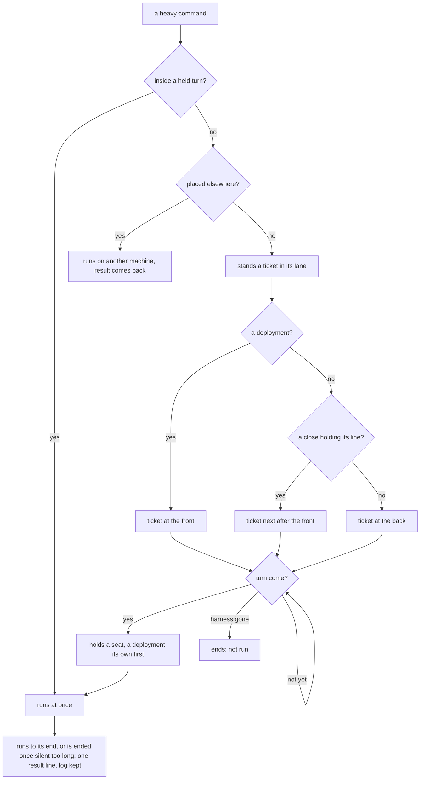

# The testbed: a machine's heavy commands in line

## What it is

- **The queue every heavy test and build command on a machine stands in,** whatever harness runs it and
  whatever repository the harness works in: a whole suite, a Cargo build or test, a package script that
  tests, checks or builds, a browser run.
- **Two lanes** (「The lanes」): the wide lane, a few seats sharing the machine's width, and the
  narrow lane beside it, one seat on a quarter of it. A command takes one seat and runs on its share
  of the lane's width; a deployment stands ahead of every other command and has a seat of its own in
  each lane besides. A further seat is taken only while the machine has memory to spare (「Memory」), so
  commands side by side never run it out of memory and into swap, where a sound change fails its check
  for a run it never saw.
- **A seat's holder runs on its share of the threads.** Each language's runner is handed the share
  (「The width」), so commands that use a few threads each run side by side instead of one after the
  other.
- **A deployment stands at the front, in a seat of its own** (「The front of the line」), so it never
  waits behind the line, and waits for a running command only where memory is short or another
  deployment holds its seat.
- **The close holding its repository's close line stands next** (「Next after the front」), behind a
  deployment and ahead of every other caller.
- **Only what needs the machine stands in line.** A light command runs where it stands, beside any
  holder (「What goes through it」).
- **Callers still work side by side.** Only their heavy commands queue; editing, reading and light checks
  go on while another harness's tests run.

## What goes through it

- **Taken by the testbed's own verbs with no word from the caller:** a run of the suite
  (`docs/suite.md`), the Cargo verb where its Cargo command compiles, and a deployment's build steps
  (`docs/deploy.md`). Formatting and Cargo's reading verbs run where they stand.
- **Never through it: the prune of the shared Cargo build directory.** It holds Cargo's own build
  lock, standing at the front of that lock's line, and does no work the machine's threads are wanted
  for; behind the wide lane's queue it would wait out every heavy command while the disk fills
  (`docs/deploy.md`, 「The Cargo build directory」).
- **The narrow lane** is for a heavy command that takes gigabytes but only a few threads: a front-end
  type check or production build. A declared check step names the narrow lane for itself
  (`docs/declaration.md`).
- **Any other heavy command is run through the testbed by its caller,** in the wide lane, or in the
  narrow one with `--narrow`: the `run` verb (`docs/boundary.md`).
- **Which commands are heavy** is each language's own answer (「Languages」): a build or test run of
  Cargo, a `bun test` over more than one file, a directory, a name that may match several or a
  browser test, a package script that tests, checks or builds, `node --test`, Vitest, Jest and
  Playwright.
- **What is not heavy:** a `bun test` of one named test file that opens no browser, run once or again
  and again with `--rerun-each`, a type check, the quick checks, a format check, and Cargo's reading
  verbs. Queuing a one-second check behind a three-minute suite costs a harness more than the memory it
  saves.
- **A close holds a seat of the wide lane through each part of its check.** It stands in its
  repository's close line (「The close line」), and inside it holds one seat through its static check
  and again through its suite, standing next after the front.

## A shell hook sends a harness's heavy command to it

- **A harness's shell hook asks the `classify` verb** whether a command line holds a heavy command
  (`docs/boundary.md`). The line is read as the shell splits it, by a shell-language parser: a
  variable the line itself assigned is read as its value, and text run as a command (a string handed
  to `eval`, `source` or a shell's `-c`, a command substitution in the command position) is read as a
  command too. A line the parser cannot read is no command at all.
- **A heavy command started outside the testbed is refused by the hook,** and the answer names the
  line to run instead: the same command after the testbed's `run` and `--`.
- **What is let through:** a light command no language claims, a run of the testbed itself, and a
  command the hook's own consumer names as one that takes the turn itself (`--takes-turn`).

## The lanes

- **The wide lane** is the machine's whole width, shared by its seats: `seats` in the lane policy,
  three, and `BMO_TESTBED_SEATS` names another number for a machine or a test. A command takes one
  seat.
- **The narrow lane** runs beside it on a quarter of the width, one seat, one command at a time.
- **Each lane has a deployment's seat besides,** which only a caller at the front takes (「The front of
  the line」). It is not counted among the lane's seats: not in the share of the width a holder runs
  on, and not where a lane is asked whether every seat is held.
- **Why seats:** most heavy commands are a check or a build of one repository that keeps one or two
  threads busy for seconds, so holding the whole machine for each leaves most threads idle while a
  line of the same waits for minutes. A few seats side by side keep the threads busy; the memory gate
  (「Memory」) keeps them from running the machine out of memory.
- **Why a narrow lane beside it:** a front-end build keeps two or three threads busy for a minute and
  takes three to six gigabytes, so it stands apart, one at a time, out of the wide lane's line.
- **Each lane has one queue,** in the order asked, with its own front; each seat is a lock of its own
  with its own holder.

## The turn

- **A seat is one lock in the machine's temporary directory.** The wide lane's first seat is
  `bmo-testbed.lock`, its further seats `bmo-testbed-seat2.lock` and on beside it, and the narrow
  lane's one seat `bmo-testbed-narrow.lock`. A lane's deployment's seat stands beside its first seat
  with `-front` before `.lock`: `bmo-testbed-front.lock` and `bmo-testbed-narrow-front.lock`.
  `BMO_TESTBED_LOCK` names another first wide seat, the
  rest beside it, which is how a test holds a turn of its own. A taker of the first seat's lock alone,
  outside the seats, never marks its ticket seated, so everyone behind it waits until it lets go.
- **The lane's one queue hands its seats out in the order asked.** Only the first ticket not yet
  seated may take a seat: a ticket that has taken its seat is marked seated and stands ahead of
  nobody. The first unseated ticket takes any free seat open to it, where the memory gate lets it
  (「Memory」).
- **Each waiter's ticket says who it is:** the caller's opaque scope where `BMO_TESTBED_SCOPE` names
  one, its checkout, the command, its process and when it asked.
- **The holder writes a record beside each seat it holds** naming itself, its process and when the
  turn came, and takes them away when it lets go. A record whose process is gone is read as nobody's.
- **A command started inside a held turn runs at once.** The holder hands its children
  `BMO_TESTBED_HELD`, its own process number, and a command that finds that number holding any seat
  of its lane takes the turn as its own, in the holder's seats: a deployment's suite, a build inside a
  static check and a package script's inner `cargo test` never wait behind the turn their own caller
  holds.

## The front of the line

- **A deployment stands at the front of every lane,** it and everything it starts. Its ticket stands
  ahead of every other ticket; deployments among themselves keep the order they asked in.
- **It takes the lane's deployment's seat first,** which no other caller takes, so the commands holding
  the lane's seats never stand in its way: each heavy command of a deployment, its static check's steps
  and its suite among them, finds that seat free and runs at once. Where another deployment holds it, it
  takes the next of the lane's own seats that frees, ahead of everyone.
- **It waits for a running command only where memory is short:** the memory gate holds for its seat
  as for any other (「Memory」), so a deployment waits at most for what is already running to free
  enough memory, never for a command queued behind it.
- **The holders are never cut.** A deployment runs beside them, on one seat's share of the width
  (「The width」).
- **A deployment says so through `BMO_TESTBED_FRONT`,** set by the deployment's verbs for themselves;
  a caller inside a harness's call is never stood at the front, whatever it sets.

## Next after the front

- **A caller standing next stands behind every deployment and ahead of every other ticket:** the
  close holding its repository's close line, its hold on the wide lane and every heavy command it
  starts. Callers standing next keep among themselves the order they asked in.
- **It takes one seat,** as an ordinary caller does: closes of several repositories check side by
  side, and none holds the whole machine through its check.
- **The holders are never cut,** as for the front.
- **A close says so through `BMO_TESTBED_NEXT`,** set for its own commands once its turn in the close
  line has come. Unlike the front, a caller inside a harness's call may stand next, since a close runs in
  one.
- **A caller standing next waits its turn out** (「Waiting never fails a command」).

## The close line

- **One line per repository on a machine,** every close of that repository standing in it, the first
  to ask going first. Its lock stands under the data root's locks, keyed by the repository's common
  git directory, so every worktree of one repository shares it.
- **One close checks at a time because a check is of what lands.** In the line each close rebases onto
  the main the close before it landed, so its check runs once, on the commit that lands.
- **The deployment of that commit takes the close's suite as its own.** The close's whole suite is a
  test run in the record of the machine it ran on, with the commit and whether the tree was clean as it
  began; where it passed, the deployment's gate runs its static check and leaves its suite out
  (`docs/deploy.md`, 「What the deploy run does, in order」, step 3), so the suite runs once per commit.
- **A close waits its turn out** while its harness lives, and leaves the line once its harness is gone.
- **It holds a seat of the wide lane through each part of its check** while it holds the line, and
  lets the seat go while it rebases, lands and writes down. Between the two parts a deployment still
  waiting at the front, its own seat held by another deployment, goes first.
- **While it waits it says where it stands** every thirty seconds: how many closes stand ahead and
  which one holds the line.
- What a close does inside its turn is its consumer's; the testbed supplies the line, the hold on the
  wide lane and the status.
- **A close run outside the testbed holds its line through the `close-line` verb** (`docs/boundary.md`), whose
  process holds the line until the close lets it go, so the line goes the moment that process ends.
- **Several lines are taken in one order,** the order of their lock files' names, whatever order a holder
  names them in, so two holders of lines they share never each hold a line the other waits for.

## Waiting never fails a command

- **Every caller waits for its turn however long the line takes:** a caller inside a harness's call, a
  deployment, the daily whole run and a person's shell alike. A caller is inside a harness's call where
  `CLAUDE_PID` names the harness's process.
- **A waiter whose harness is gone leaves the line,** since nobody is left to run what it waits for. Its
  command does not run, and says so: a line naming its place and the holders, a verdict of not run with
  nothing tested and nothing failed, and exit code 75. That is the one way a waiter leaves the line without
  its turn.
- **While it waits it says, every thirty seconds, its place in the line and who holds the lane's
  seats,** so a reader sees it is queued and not stuck.

## A holder that dies lets go

- **A holder process that dies lets its seats go with it:** each seat's lock goes the moment the
  process holding it ends, and the next in line takes it.
- **A harness that dies holding the turn lets it go too.** The holder of a harness's turn watches the harness's
  process named in `CLAUDE_PID`; once that process is gone the watch kills the holder and every process
  under it at once, since nobody is left to read what they would answer, and its seats go with them.

## A holder whose command falls silent lets go

- **A command holding a lane's turn that neither writes nor works for the silence limit is ended as hung,**
  and its seats pass on. Its length alone never cuts it: a command that keeps writing or working runs until
  it ends, however long that takes, and a person who wants it gone stops it.
- **The silence limit is ten minutes,** or the seconds a repository's declaration names in `[test]
  silence_seconds` (`docs/declaration.md`): every watch over a command run for that repository, in its
  checkout or a bench copy of it, keeps to the declared number.
- **A slow command is not a silent one, and the limit is never stretched for a slow one.** A static check
  or a deployment's gate gets no longer limit than any other command, and a check needs no warm build
  directory to stay under it. A command that computes without a word, such as a typechecker that speaks
  only once it ends or a bundler transforming its modules, burns processor time the whole while, so it is
  working, however slow the machine and however long it lasts. A command that neither writes nor works for
  ten minutes is waiting on something, a lock, the network or a process that will not end, and that wait is
  the hang the limit is there to end. A repository whose own work waits longer by its nature, and not
  because something it waits on never comes, names its `silence_seconds`.
- **The holder watches where its command's output goes,** every three seconds: the log of a `run`, the
  files a check step's output is taken into, the pipes a suite's unit, a deployment's heavy step or a placed
  run's command is read through, and the files the Cargo verb's own standard output and error stand in.
- **At every look it also reads the processor time the command's processes have used,** the command it
  started and every process under it, as the kernel counts each one's time. Where they used at least the
  lane policy's share of one processor since the last look, the command is working. A process waiting on a
  lock, a socket or a child burns next to none, so a waiting command stays silent however many processes
  stand under it. A command spinning with nothing to show is working by this reading, and runs until a
  person stops it.
- **Once none of its output has grown and it has not worked for the limit, the command is hung.**
- **A command under it that is watched in turn speaks for it.** The holder hands its command
  `BMO_TESTBED_HEARD`, a file of its own; a watch under it, such as a suite's over a unit whose output it
  holds back until the unit ends, touches that file while its own command writes, and the holder counts the
  touch as its command writing. A command waiting for memory to free before it runs again
  (「Memory」) touches the file each time it looks, so the wait is never taken for silence.
- **A run placed on another machine is watched where it runs** (「A run on another machine」). The
  `placed` verb there passes its command's standard output and error on as they come, through pipes of its
  own, counts every byte as the command writing, reads its command's processor time as every holder does,
  and hands the command `BMO_TESTBED_HEARD`; so a placed command whose own output is that pipe, such as the
  Cargo verb's, is ended as hung on that machine at the limit, its seats there pass on, and the line and
  code 124 come back over the connection. The declared setup a placed run starts with is watched the same
  way.
- **What the `placed` verb hears without a byte passing it says over the connection:** while its command
  works or the file it handed it is touched, and nothing of the command's own output has come through for
  a minute by the lane policy, it writes one line on its standard error saying the command still works
  there. So a watch on the calling machine over the connection, such as a deployment's over its heavy step
  run there, hears a placed command that computes or holds its output back as working.
- **The caller passes a placed run's output on the same way,** and while bytes come over the connection it
  touches the file its own holder handed it in `BMO_TESTBED_HEARD`. It ends nothing itself: a placed
  command that holds its output back, a `run` writing to its log there or a check whose step still runs, is
  heard only by the watches on that machine, and the caller says once a minute that it still runs there
  (「A run on another machine」).
- **A hung command is ended whole:** its process group where it heads one, and every process under it, are
  sent a TERM, and whatever still stands ten seconds later a KILL.
- **It says so in one line,** `testbed:` first, naming the command, where its output went, the limit and
  what still stood under it as it was found silent: each process of its tree that had started nothing
  further, by its command line, four at most, since the process at the end of a chain is the one that waits
  and the command the watch started is only where the chain begins. It ends as failed with exit code 124, never as passed: a `run` on that code, a check's step and a suite's
  unit as failed with it.
- **A person's command whose output is a terminal or a pipe is not watched:** the Cargo verb whose
  standard output or error is a screen, another program or anything but a file runs until it ends, since
  nothing the testbed reads says whether it still writes there. On a placed machine the `placed` verb
  above it is that watch.
- The default limit, the pause before the KILL and how often the holder looks stand in the lane policy.

## Open files

- **Every verb raises its own limit on open files to the machine's ceiling** as it starts: the soft limit
  is set to the hard one, so a run, a suite, a change check, a placed run and everything each starts
  inherit it. A shell's own soft limit, a thousand files on a WSL machine, is far below what a suite of
  servers and clients standing side by side holds open, and a test that meets it fails with "Too many open
  files" for no fault of its commit. A limit that cannot be raised is left as it stands.

## Memory

- **A seat beside a held one is taken only while the machine has memory to spare:** the first
  unseated ticket takes a free seat where the memory available, as the kernel's `MemAvailable` says
  it, is at least `seat_free_gigabytes` in the lane policy, four, or where no seat of the lane is held
  at all, so a lone command always runs. `BMO_TESTBED_SEAT_FREE_GB` names another amount for a machine
  or a test. A deployment's seat is a seat beside the held ones like any other.
- **A command the kernel killed for want of memory runs again,** at most four runs in all: before each
  further run the testbed waits at least thirty seconds, then until six gigabytes are free, however long
  that takes, saying every minute that it still waits. The Cargo
  verb and a declared check step that asks for it do so (`docs/declaration.md`); a plain `run` does
  not. A command ended as hung is not run again, since it would hang again.
- **A failed run during which a fence it stands in reached its own ceiling is not run again,** whether
  or not the machine's count of out-of-memory kills could be read or moved: the fence's own count says
  the ceiling was met, and the same run would meet it again. The line names the fence, its ceiling and
  how the run ended.
- **A run a signal ended and nothing took for a memory kill says so** on a line naming the signal and
  the exit code it ends on, 1, so a command killed from outside never reads as one that failed.

## The width

- **The wide lane's width is the machine's thread count.** `BMO_TEST_PARALLEL` sets another;
  anything that is not a positive whole number means the default.
- **The narrow lane's width is a quarter of it,** and never less than one.
- **A holder runs on its share of the lane's width:** the width divided by the lane's seats, never
  less than one, for each seat it holds, a deployment's seat counted as one of them. A command
  inside a held turn runs on its holder's share.
- **Each language hands the share to its runner its own way** (「Languages」): a `bun test` worker
  count, Cargo's jobs, Node's test concurrency, Vitest's and Jest's workers. A command that already
  names its own number keeps it. The Cargo verb hands Cargo its share as its jobs where neither its
  words nor its environment name them, and a whole run of the suite sizes its sweep by its share.
- **Browsers run narrower:** Playwright is handed a quarter of the width, since every worker drives a
  browser of several hundred megabytes.

## The result

- **A run ends on one line,** opening with `testbed:`: whether it passed, the language that read it,
  how many tests passed, failed and were skipped, the seconds it ran, the seconds it waited for its
  turn, and the log. A command that is not a test run says its exit code instead of counts.
- **Under a failure it prints what failed,** read out of the output by the language that ran it: the
  failing tests, each with the lines its panic left under it where the language reads them, or a
  compiler's errors, at most sixty of them.
- **The whole output goes to the log,** under `testbed/` in the data root, one file per run, never to
  the caller's screen. Logs older than a week go when the next run starts.
- **Every heavy command says how long it waited and how long it ran.**
- **A caller that wants them written down names a file in `BMO_TESTBED_TIMES`:** every turn taken
  under it adds one line there: the command, its lane, its wait and its run. A static check reads its
  steps' waits back that way.

## A run on another machine

- **A heavy run that can be placed may run on another machine** before it asks for its turn. Where it
  goes is the machine's placement (`docs/boundary.md`, 「Placement」): the placed machine its settings
  name, reached over `ssh`, or the placement endpoint's answer; with neither, or an endpoint that does
  not answer, the run stays on the machine it was started on.
- **The settings put the machines in order,** this machine among them (`docs/boundary.md`, 「The placed
  machine」, `order`). A run that can be placed goes to the first machine in the order with a seat of its
  lane free now and nobody waiting for one, and falls to the next only where every seat there is held or
  waited for. The last machine in the order takes it whatever it holds, and the run waits in that
  machine's line. So the order alone says which machine's seats are used first, and which machine a run
  waits on once every machine is full.
- **A placed machine is never passed over for being out of reach or behind:** a run that comes to it
  waits for it to answer and brings its testbed to the live release (below), and where neither can be
  had it ends as not run rather than running here. What runs on this machine is what the order sends
  here, never a run that fell back because the placed machine was away.
- **What can be placed:** a `run` of a heavy command, in either lane, a Bun test, a type check, a
  package script or a browser test among them; a whole run of the suite; `test`, `check` and `clippy`
  through `bmo-testbed cargo`, which run there as the same verb of that machine's testbed; and the change
  check, `bmo-testbed check` with no part named, which is placed whole and runs there as that machine's
  own change check over the same commit and open files, its steps in that machine's turn, its log staying
  on that machine and named in the lines that come back. The commit its `--since` names is resolved here
  and handed over as the commit itself, since a name such as `origin/main` names a commit only in this
  checkout and the bench there holds none of its references.
- **A change check over several checkouts is placed whole as one set** (`docs/checks.md`, 「The change
  check over several checkouts」): every checkout laid in one bench there at the place it has under this
  machine's home, the set run there as that machine's change check in one wide seat of its line. It goes
  by the settings' `combined_order`, whose default is the placed machine alone, so a busy placed machine
  is waited for in its line and the set never falls to this machine; it runs here only where that order
  names this machine or the settings name no placed machine at all, and the placement endpoint refuses it
  rather than running it here (`docs/boundary.md`, 「Placement」).
- **What stays here, whatever the order says:**
  - a run started inside a turn already held, since its holder's seat is here and it stands in it;
  - a run inside a deployment's or a whole run's unit, since those hold their own place in this
    machine's line, and a deployment's own heavy work goes to the placed machine by its own rule
    (below);
  - a run started on a placed machine, which is never placed again;
  - a run started in a checkout holding a file its declaration names as reaching what only this machine
    reaches, `[runner] local_files`, such as a test environment kept out of git that points at servers
    on this machine's loopback, since the copy carries no file git ignores and the servers stand here;
  - a run whose environment sets a variable the checkout's declaration names as reaching what only this
    machine reaches, the address of a console standing on this machine's loopback among them, since a
    placed run carries none of the caller's environment;
  - a run started in a folder the bench copy leaves out, said on a line naming it: a folder git
    ignores in its checkout, or one inside such a folder, since the bench would not hold the folder the
    command runs in;
  - a Cargo verb whose output this machine reads afterwards: a build, a run or any other subcommand that
    is not `test`, `check` or `clippy`, a `--no-run`, and words naming an absolute path, which would
    point elsewhere there;
  - a change check with a part named: the quick checks are light, and the static check alone is the part
    a deployment's gate runs in its own bench;
  - the light commands no lane takes, which cost less where they stand than the copy a placed run makes.
- **The testbed there is brought to this machine's live testbed release before anything runs there.**
  The live release is the one the testbed's deploy tree names now, read at the moment of asking, never
  the release of the process that asks: a process started from an older release, such as a deployment
  that began before the testbed's own deployment went live, sees the newer release live and never brings
  that machine back to its own. Where the commit the `built-from` beside that machine's testbed names
  differs from the live release's, or none reads there, the live release's testbed is copied there and
  run there once, so a copy that does not run there is found at once, and only then its `built-from`,
  which is read back; it is said on a line naming the machine and the commit. One
  process of this machine compares and copies at a time, under one lock, the live release read again
  once the lock is held, so a copy of a release no longer live never lands over a newer one. A testbed
  running from no release, such as a checkout's own build, compares nothing (`docs/boundary.md`,
  「The placed machine」).
- **Where the testbed there cannot be brought to the live release while the machine answers,** the run
  ends as not run, exit code 75, on a line naming the machine, both commits and what the machine
  answered, and sends `placed-release-failed` once for that live release (`docs/boundary.md`, 「Events」);
  nothing runs here in its stead. A deployment's gate and build fail their stage instead (`docs/deploy.md`, 「Where a deployment
  runs」).
- **A placed machine that cannot be reached is waited for.** The run asks it again every thirty seconds,
  saying on a line each time that it waits, for how long so far and what the machine's `ssh` said, and
  goes there once it answers. It holds no seat here and starts nothing here meanwhile, so a wait costs
  this machine the waiting process alone, where the same run here would take a seat and the memory its
  command needs. The wait is bounded at twenty minutes (the lanes policy's), which outlasts the few
  minutes a placed machine whose connection drops stays away: then the run ends as not run, exit code 75.
  A deployment waits by its own rule (`docs/deploy.md`, 「A connection that breaks under the placed
  machine」).
- **A placed run says it still runs while nothing comes back.** From the moment a run goes to the placed
  machine until it ends there, every minute in which no byte of its output came over the connection (the
  lanes policy's, or the milliseconds `BMO_TESTBED_PLACED_STANDING_MS` names for a test), the
  caller says on standard error that it still runs there and for how long so far: through the wait for the
  machine to answer, the lock and the copy that bring its testbed to the live release, the copies that make
  its bench ready, its wait for its turn there and a command there that holds its output back, such as a
  `run` writing to its log there. A caller waiting on another machine burns next to nothing here, so
  without the line a watcher of its output could not tell it from a hung one. A run whose output keeps
  coming back says nothing more. The line says nothing of the run's health: a hung command is ended by the
  watches there (「A holder whose command falls silent lets go」).
- **An outage is told once, and its end once.** The first run that gives up on a machine sends
  `placed-unreachable`, and the runs that give up after it in the same outage send nothing more; the first
  process that finds the machine answering again sends `placed-recovered`. Both go to the machine's own
  hook, the one `env/testbed.env` names where the caller names none, and where neither names one, to the
  owner's supervisor as a notice through the receiver (`docs/boundary.md`, 「Events」, 「The placed
  machine」, 「`notice`」). `status` shows when a standing outage began.
- **There it runs in a bench copy of the caller's checkout under that machine's own testbed:** the
  caller pushes its commit into a clone of the checkout's remote in the bench, the remote a support
  checkout's main checkout names where the support checkout's own is a path on this machine, copies its
  open files over, and copies every tree the checkout's workspace names outside the repository to its
  own place under the bench root; the checkout's setup then runs there, and the command in that
  machine's own turn, on its own seats and its own memory gate. Its output and its one result line come
  back to the caller.
- **The copy carries what git itself sees in the tree:** git names the paths it ignores there, by its
  own rules, every `.gitignore` with its `!` lines, the repository's exclude file and the account's,
  and those alone are left out. So an untracked file a `!` line takes back reaches the bench, and a file
  deleted here is deleted there. What the bench's own git ignores there stays, such as an installed
  package or a build's output, whether or not the checkout here holds it. The copy of an outside tree
  there holds no repository, so it keeps what git ignores in the tree here, and the rest of it is what
  the tree holds here. A tree that no git repository holds has no ignore rules to read, and the run
  ends as not run on a line naming it rather than copying it whole.
- **The command runs where the caller stands in its checkout:** a run started in a folder below the
  checkout's top runs in the same folder of the bench, so a package script, a test path or a language
  read from that folder means there what it means here; the setup still runs at the bench's top. A
  suite, a change check and a Cargo verb start from the checkout's top here, and so they do there.
  The folder a run is sent from is one the copy carries, since a folder it leaves out keeps the run
  here (above); a bench that holds no such folder all the same runs nothing and says so on a line
  naming the folder (`docs/boundary.md`, 「`placed`」).
- **A deployment's gate and its Cargo release build go to the placed machine** the settings name,
  whatever the order says (`docs/deploy.md`, 「Where a deployment runs」), so the machine that serves is
  not the machine that checks and builds.
- **A caller keeps its place in the line there:** one standing at the front (「The front of the line」) or
  next (「Next after the front」) here stands the same on the placed machine, the line run there carrying
  `BMO_TESTBED_FRONT` or `BMO_TESTBED_NEXT` as it stands here. A deployment's gate and release build
  therefore take that machine's turn ahead of every run placed there that is no deployment's.
- **The machine that placed it still names it** while it lasts: an entry of its lane's placed runs,
  naming the machine and whether it waits there or its turn there has come, which `status` prints and
  the service answers (`docs/boundary.md`, 「A run placed elsewhere stands here too」). It holds no seat
  here.
- **A run started on a placed machine stays there.**
- **A machine that drops it** ends the run as not run, exit code 75, and the same command run again
  goes where the placement sends it next. A deployment's gate and release build there are tried again
  instead (`docs/deploy.md`, 「A connection that breaks under the placed machine」).

## Seeing the queue

- **The `status` verb** prints each lane: its width, who holds each seat held and since when, a line
  for each seat, or nobody, and who waits behind them in order, with the front and the next marked, and
  each run this machine placed on another in that lane, waiting or running there; then the close line of
  the repository it is run in, its holder and who waits behind it; then the placed machine the settings
  name, whether it answers, the release its testbed is built from and whether that is this machine's live
  testbed release. `--json` gives the same as structure (`docs/boundary.md`).

## Languages

- **A language is one member of the language type in `core`:** a module of its own, answering what
  the common type asks, and named once in the list of members beside it. The run, its result and the
  `classify` verb ask that one list, so nothing else names the languages.
- **What a language answers:**
  - its name, which the result line shows and `--adapter` forces;
  - whether it claims a command, read from the program and the words after it as the shell split them;
  - the command as it runs in its turn: its share of the width handed to the runner, through an
    argument or the environment;
  - what a run's output adds up to: how many tests passed, failed and were skipped;
  - what failed, as short lines out of the output;
  - for a language that runs test files, its own naming of a test file, and the command that runs
    test files, handed the caller's words, with no per-test limit of its runner's own standing, and each
    file by its path from the folder the command runs in;
  - for a language whose runner takes a per-test limit, the words that hand it one, which the suite and the
    change check add to the caller's words unless those name a limit already (`docs/suite.md`, 「How long a
    unit and a test may run」);
  - for a language whose runner says, while a test runs, that the test has been running long, that line
    read as the test and how long it had run, and its result line read as the test ended;
  - for a language whose runner names, in its output, the test files that held a failed test, those
    files, and for one whose runner ends its output on a result of its own, the tests that result names
    as failed, none where no result stands, with the words that run only those tests, each matched by
    its full name (`docs/suite.md`, 「What failed runs once more」);
  - for a language whose runner reads a configuration file of its own from the folder it starts in,
    that file's name, which decides the folder its test files run from (`docs/suite.md`, 「Which
    files run」);
  - for a language that runs package scripts, the command that runs a project's script;
  - for a language whose toolchain a machine installs apart from the repository, the command that says
    which toolchain it is, which the `toolchain` verb runs (`docs/boundary.md`, 「`toolchain`」);
  - for a language whose commands may name a toolchain of their own, the toolchain a command names and the
    component of it the command runs that a toolchain may be installed without. Before such a command
    runs, the machine's toolchain installer is asked whether that component runs on that toolchain, with
    its own installing on demand held off so the asking changes nothing, and where it does not, the
    toolchain is installed with its minimal profile and that component alone, said on a line before it
    and on another where the install fails, the command then left to say why it cannot run. A machine
    with no installer is left as it stands;
  - for a language of a package workspace, its root configuration, the files at the repository's root
    a change to which reaches every package, and the name of its lockfile, which marks a folder
    carrying it beside a package manifest as a project of its own (`docs/checks.md`, 「Which tests a
    change runs」).
- **The ones there are:**
  - `bun`: `bun test` over anything but one test file; its test files are named `*.test.ts`, run by
    `bun test` handed each file as a path from where it runs (a word that is not written as a path
    is a filter bun matches within every test file's path) and `--timeout 0`, which lifts bun's own
    per-test limit unless the words name one; it hands a per-test limit as `--timeout` in milliseconds, it
    names a test file holding a failed test by the file's own heading above the test's `(fail)` line, its
    configuration is `bunfig.toml`, and
    it runs a project's script with `bun run`. Its root configuration is `package.json`, `bun.lock`,
    `bunfig.toml` and `tsconfig.json`, and its lockfile `bun.lock`;
  - `cargo`: build, check, clippy, test, bench, doc and nextest; it reads Rust's test harness saying a test
    has been running for over a number of seconds, and a test's `ok`, `FAILED` or `ignored` result line;
    its failed tests are the `FAILED` ones above the harness's `test result:` line, and it runs only
    named tests by handing them after `--exact`. What failed names each failed test with the lines of its
    own `---- <test> stdout ----` section from the panic, or from the section's first line where nothing
    panicked, to the first blank line or note, at most as many as the policy names, and each compiler error
    with the place it names. A command names its toolchain with a leading `+`, and `fmt` runs that
    toolchain's rustfmt;
  - `node`: package scripts that test, check or build under npm, pnpm, yarn or bun; `node --test`;
    Vitest; Jest. Its test files are named `*.test.js`, `*.test.mjs` and `*.test.cjs`, run by
    `node --test`, and it runs a project's script with `npm run`. Its root configuration is
    `package.json`, `package-lock.json` and `tsconfig.json`, and its lockfile `package-lock.json`;
  - `browser`: Playwright, and a `bun test` file under a `browser` directory, which it runs as bun
    does, by bun's configuration;
  - `cargo` and `node` read no configuration file of their own, so their test files run from the
    repository's root; `cargo` and `browser` name no root configuration and no lockfile, since a
    Cargo workspace is read through `cargo metadata` and a browser file stands in bun's workspace;
  - their toolchains are said by `rustc -vV` for `cargo`, `bun --version` for `bun` and
    `node --version` for `node`; `browser` names none, since it runs on bun and its browsers are the
    packages the lockfile pins.
- **A command no language claims** still runs through the testbed when it is started there, read by
  the plain language, `plain`: its exit code, its time, and the last lines of its output on a
  failure.

### Adding a language

1. Write one module in `core`'s languages, named after the language, a member of the common language
   type, and add it to the list beside them.
2. Claim only what is heavy: a run that compiles a project or runs many tests. A light command claimed
   there is refused by the hook and queued behind every suite on the machine.
3. Widen through the runner's own handle and leave a number the command already names alone.
4. Read counts from the runner's own summary lines and sum every block, since many runners print one
   per file or binary.
5. Where it runs test files or package scripts, answer its naming and its commands for them, and
   where its runner reads a configuration file of its own, that file's name; for a package
   workspace, its root configuration and its lockfile; for a toolchain the machine installs, the
   command that says it.
6. Put a test in `core`'s tests that holds a claimed command, an unclaimed one, the widening, a
   summary read back, and its naming, commands, configuration and workspace files where it has them.
7. Nothing else changes: `classify`, the run, its result, the suite, the check and `toolchain` read the list.
   Adding a language is a minor version (`docs/boundary.md`, 「Versions」).
